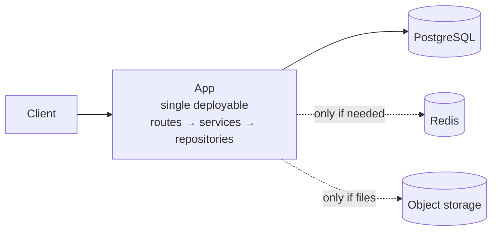

# Level 1 — Prototype / POC / Mini Project

**Optimise for learning speed.** The system's job is to answer a question — does this work, do users
want it, can the model do this — as cheaply and quickly as possible. Architecture that does not
serve that question is waste.

**Rough shape:** fewer than ~1K users, under ~10 QPS, data that fits comfortably on one disk, one to
three engineers, downtime measured in "we'll fix it tomorrow".

---

## 1. The default architecture



That is the whole thing. One deployable, one database, managed hosting, deploy on git push.

| Component | Choice | Notes |
|---|---|---|
| **App** | One process, one repo, one deploy | FastAPI or NestJS. Layered internally so the seams exist, but one artifact |
| **Database** | PostgreSQL, managed | Azure Database for PostgreSQL, RDS, Supabase, Neon. Migrations from the first table |
| **Object storage** | Only if you handle files | Never store blobs in the database |
| **Redis** | Only on a measured need | Cross-instance sessions, rate limiting, one genuinely expensive computed result |
| **Hosting** | PaaS or container service | Azure Container Apps, App Service, Fly, Render, Railway. **Not Kubernetes** |
| **CI** | One job: tests + lint on push | One job, not a pipeline |

### Internal structure

Keep the monolith layered so that a future split is a refactor rather than a rewrite:

```
src/
  api/          ← routes, request/response schemas, validation
  services/     ← business logic; no framework or DB types leak in
  repositories/ ← all SQL lives here
  models/       ← domain types
  config/       ← environment loading, one place
```

The single rule that preserves optionality: **`api/` never imports from `repositories/` directly.**
Everything goes through `services/`. This one constraint is what makes the L1 → L2 transition cheap.

---

## 2. What earns its place at L1

Small but non-negotiable — cheap now, miserable to retrofit:

- **Migrations** — schema in version control from the first table. There is no "we'll add migrations
  later" that ends well.
- **One config mechanism** — environment variables, secrets out of git. This is 12-Factor's config
  rule, and it is the one factor that matters immediately, because it is what lets the same artifact
  run in two places.
- **Structured logs with a request ID** — JSON to stdout with an ID you can grep. Not a logging
  platform. This is what makes the first production bug survivable.
- **A health endpoint** — every platform wants one, and defining it forces you to know what
  "healthy" means.
- **Input validation at the boundary** — Pydantic / class-validator / zod. Prevents the entire
  injection class and most of the "why is this field null" class.
- **Parameterised queries.** Always. There is no prototype excuse for string-concatenated SQL.
- **Hashed passwords** if you own auth — `hash(password + per-user salt)` with bcrypt or argon2.
  Never plain, never a bare hash (rainbow tables). Better: **do not own auth** — use a managed
  identity provider and inherit their controls.
- **Backups** — managed Postgres gives them free. Confirm they exist and **restore one once**.
- **A README that says how to run it** — the difference between a prototype and an artifact someone
  else can pick up.

---

## 3. What does NOT earn its place at L1

Each of these is a real pattern solving a real problem you do not have yet. The discipline is to
**write down the trigger** rather than either adopting it or pretending it will never be needed.
That converts an argument into a tripwire.

| Not yet | Why not | Trigger to reconsider |
|---|---|---|
| **Microservices** | One team, no independent deploy pressure | Two teams blocking each other on releases |
| **Kubernetes** | Enormous operational surface for one container | Many services with real scaling and scheduling needs |
| **Message queue** | Adds async debugging, DLQs, idempotency requirements | A request must do >2 s of work the user should not wait for |
| **Kafka** | An event-streaming backbone for one producer | Multiple independent consumers need replayable history |
| **Read replicas** | The single instance is nowhere near saturated | Read CPU sustained above ~70% |
| **Sharding** | Nothing about your data requires it | See L3. You are very far away |
| **CQRS** | Doubles the model count | Read and write workloads have genuinely divergent shapes and volumes |
| **Event sourcing** | Permanent event schema, replay cost | A real regulatory audit trail or temporal query requirement |
| **Service mesh** | Nothing to mesh | You are at L3 |
| **Multi-region** | Doubles cost, adds conflict resolution | Users on another continent complaining, or a data-residency law |
| **GraphQL federation** | One client, one API | Many client shapes across many domain teams |
| **A separate search cluster** | Postgres full-text handles a surprising amount | FTS measurably too slow, or you need faceting and relevance tuning |
| **A separate vector database** | pgvector is in the database you already have | Vector workload outgrows Postgres, measured |
| **Distributed tracing** | Two components do not need a trace | More than two services in one request path |
| **Feature flags platform** | An `if` and an env var work | Multiple teams releasing independently |

---

## 4. Async work at L1

When something genuinely takes too long for a request — sending email, generating a report,
embedding a document — get it off the request path. In order of preference:

**1. In-process background task** — FastAPI `BackgroundTasks`, `setImmediate`, a worker thread.
Fine when losing the task on restart is acceptable.

**2. A `jobs` table in Postgres**, polled by the same app:

```sql
-- claim one job atomically, skipping rows other workers hold
UPDATE jobs SET status = 'running', claimed_at = now()
WHERE id = (
  SELECT id FROM jobs
  WHERE status = 'pending' AND run_after <= now()
  ORDER BY created_at
  FOR UPDATE SKIP LOCKED
  LIMIT 1
)
RETURNING *;
```

Durable, transactional with your data, zero new infrastructure, and `SKIP LOCKED` handles
concurrency cleanly. **This covers far more ground than people expect** and is the correct answer for
most of L1 and a good deal of L2.

**3. A real queue** (Service Bus, SQS, BullMQ) — only once you need fan-out, priorities, or
independently scaled workers.

---

## 5. Data at L1

- **One database, one schema.** Do not pre-split into bounded contexts you have not discovered yet.
- **Model around the queries you will actually run.** Write three of them down before creating the
  tables.
- **Use the database's features** — constraints, foreign keys, `CHECK`, unique indexes. Enforcing
  invariants in the database is free and always correct; enforcing them in application code is
  neither.
- **Index the obvious things** — foreign keys and anything in a `WHERE` or `ORDER BY`. Do not index
  speculatively.
- **UUIDs or bigserial for primary keys** — prefer UUIDv7 or bigserial if you expect to shard later;
  random UUIDv4 primary keys hurt B-tree locality.
- **Soft deletes only where a real requirement exists.** They complicate every subsequent query.

---

## 6. AI/LLM features at L1

The prototype version of an AI feature is still a prototype:

- **Call the model API directly.** No orchestration framework until the flow has more than one branch.
- **Retrieval: `pgvector` in the Postgres you already have.** Not a dedicated vector database.
- **Log every prompt, response, token count, latency, and cost to a table from day one.** You cannot
  improve what you did not record, and this data is what tells you whether the thing works at all.
- **Version your prompts** — a `prompt_version` column next to every logged call. Without it, you
  cannot attribute a quality change to a prompt change.
- **Set a per-user cost ceiling before launch**, not after the bill.
- **Validate model output** before it touches anything consequential; never execute it blind.
- **Moderate both input and output** if the output reaches users. Most production LLM incidents come
  from omitting the output-side check.

---

## 7. Definition of done at L1

- It runs somewhere that is not a laptop
- Someone other than the author can deploy it
- A crash loses no committed data
- The logs are enough to diagnose the last failure
- **You can state what would break first if usage went 10×**

That last one is what makes the L1 → L2 transition an engineering decision instead of an emergency.

---

## 8. Signals you have outgrown L1

- Real users depend on it during their working day
- You start saying "don't deploy right now"
- One database instance is visibly warm under normal load
- A second team needs to change the code
- Someone asks about the SLA, or what happens if the region goes down
- You have started keeping a mental list of things that are only in one person's head

**Any two together → design the L2 shape.** Go to `02-level-2-production.md`.

---

## 9. The L1 → L2 migration, in order

When the signals fire, this is the sequence — each step is independently shippable:

1. **Add observability first.** You cannot make anything else safe without knowing what is happening.
   Structured logs, RED metrics, one alert on error rate.
2. **Add a second instance behind a load balancer.** This forces statelessness and reveals every
   place you were relying on local state.
3. **Move sessions and rate limits to Redis** (the thing the previous step just broke).
4. **Add a staging environment** and stop deploying from a laptop.
5. **Add a read replica** if reads are the pressure; add a queue if slow work is the pressure.
6. **Write down the runbook** for the three most likely failures.

Do not do all six at once. Each one exposes problems that are easier to fix in isolation.
