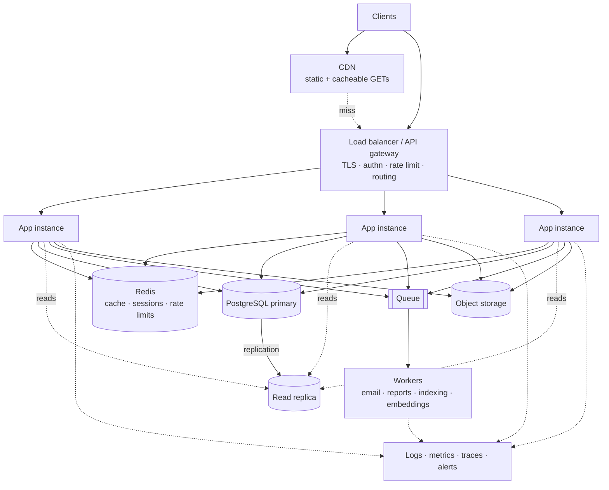
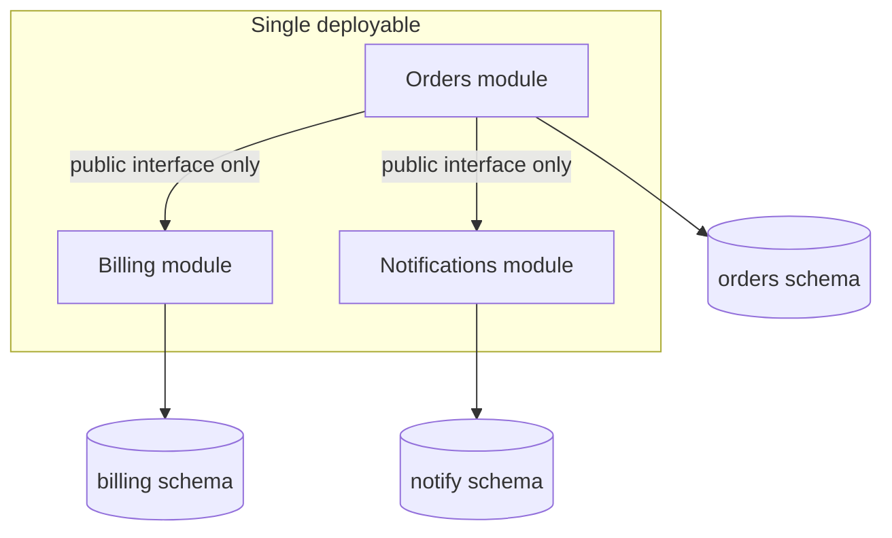

# Level 2 — Mid-size Production System

**Optimise for reliability and team velocity.** Real users depend on this. Downtime costs money.
Multiple engineers ship to it concurrently. But you are not fighting physics yet — one good database
still holds the whole dataset, and a handful of app instances still absorb peak traffic.

**Rough shape:** ~1K–1M users, ~10–5,000 peak QPS, GB to low TB of data, 3–50 engineers, 99.9%
availability (~43 min/month), RTO and RPO in minutes.

This is where most professional systems live, and where most over-engineering happens.

---

## 1. The reference architecture

### The ten components of a production web application

Use this as a completeness check. If one is missing, that absence should be a **decision**, not an
oversight.

1. **CI/CD pipelines** deploying code to instances
2. **User requests** from the browser, reaching app servers after DNS resolution
3. **Load balancers and reverse proxies** (Nginx, HAProxy) distributing requests evenly
4. **CDN** serving cacheable content
5. **APIs** connecting the web app to backend services
6. **Database servers and distributed caches** providing data
7. **Job queues and workers** for resource-intensive and long-running tasks
8. **Full-text search** (Elasticsearch, Solr) — or Postgres FTS until it measurably is not enough
9. **Monitoring** (Sentry, Grafana, Prometheus) storing logs and analysing data
10. **Alerting** notifying developers (Slack, PagerDuty) for quick resolution

---

## 2. The decision that defines L2: monolith or microservices

**Answer this with team topology, not traffic.**

### Default to a modular monolith

One deployable, hard internal module boundaries, one database with per-module schema ownership, and
**no cross-module table access**.

You get transactions, cross-boundary refactoring, and one deploy — with the seams already cut for a
later split.

**Enforce the boundaries mechanically** or they rot within a quarter: package-visibility rules,
import-lint rules, architecture tests (ArchUnit, `import-linter`, dependency-cruiser), and separate
schemas with separate database roles.

### Split a service out when a specific trigger fires

| Trigger | What it actually looks like |
|---|---|
| **Independent deploy pressure** | Two teams routinely block each other on releases |
| **Divergent scaling profile** | One endpoint needs 20 instances; the rest need 2 |
| **Divergent runtime need** | A component needs GPUs, or a different language or runtime |
| **Fault isolation** | A flaky third-party integration must not take the whole app down |
| **Compliance boundary** | Card data or PII must live in an isolated blast radius |

**Bad reasons to split:** it's modern; the diagram looks better; we might need to scale later; a
conference talk. Splitting on those buys distributed transactions, network failure modes, eventual
consistency, and a tracing requirement — in exchange for nothing.

### If you do split

- **One service at a time.** Start with the clearest boundary and the least shared data.
- **Each service owns its data.** A shared database between "microservices" is a **distributed
  monolith** — all of the costs, none of the benefits.
- **Use the strangler pattern** — route specific paths to the new service at the gateway while the
  monolith keeps serving the rest. Never a big-bang rewrite.
- **Expect to need the outbox pattern** the moment a database write and an event publish must both
  succeed. See `09-messaging-and-events.md` §5.

### Nine best practices for microservices

Design for failure (circuit breakers, bulkheads, graceful degradation) · build small services, each
doing one thing well · use lightweight protocols (REST, gRPC, message brokers) · implement service
discovery (Consul, Eureka, Kubernetes Services) · **data ownership per service** to reduce coupling ·
use resiliency patterns (retry policies, caching, rate limiting) · security at every level of the
communication path · centralized logging · containerization.

Additionally: separate data store per service · keep code at a similar level of maturity · separate
build per service · single responsibility · stateless design · domain-driven design.

### Nine components of a production microservice platform

API gateway · service registry · service layer · authorization server (Keycloak, Entra ID, Okta) ·
data storage · distributed caching · async communication (Kafka, RabbitMQ) · metrics visualization
(Prometheus + Grafana) · log aggregation (Logstash → Elasticsearch → Kibana).

**This list is the real cost of the decision.** If the team cannot own all nine, the answer is a
modular monolith.

---

## 3. The scaling ladder — climb in order

Do not skip rungs. Each is cheaper and less invasive than the one after it. Full detail in
`06-data-layer.md` §12.

| # | Rung | Typical gain | Cost |
|---|---|---|---|
| 1 | **Index correctly** | 10–1000× on the offending query | None. Read the actual query plans |
| 2 | **Fix N+1 and chatty ORM patterns** | Often bigger than the index | None |
| 3 | **Materialised views** | Expensive aggregations become cheap reads | Staleness, refresh cost |
| 4 | **Denormalise the hot read path** | Removes joins from the critical path | Write amplification, update anomalies |
| 5 | **Vertical scale** | Frequently a year of headroom, one line of config | Ceiling, cost, still a SPOF |
| 6 | **Cache** | Removes most reads from the database | Invalidation, stampedes — read `07-caching.md` first |
| 7 | **Read replicas** | Scales reads horizontally | **Replication lag becomes a correctness issue** |
| 8 | **Connection pooling** (PgBouncer) | Fixes exhaustion that presents as slowness | Transaction-mode caveats with prepared statements |
| 9 | **Async processing** | Removes slow work from the request path | Eventual consistency, idempotency requirement |
| 10 | **CDN** | Offloads static and cacheable traffic entirely | Cache invalidation at the edge |

**The majority of "we need to scale the database" is rung 1 or 2.** Read the query plans before
buying anything.

**On rung 7 specifically:** replication lag is a correctness concern, not an ops detail. Decide
**per query** whether it tolerates staleness, and keep read-your-own-writes on the primary. A
read-your-own-writes bug appears only under load, which is the worst time to find it.

Only when 1–10 are genuinely exhausted do you consider partitioning — and at that point you are
entering L3. See `03-level-3-hyperscale.md`.

---

## 4. Reliability at L2

### In-process resilience

- **Timeouts on every outbound call.** No exceptions. Edge timeouts shorter than origin timeouts, so
  the caller gives up first.
- **Retries with exponential backoff plus jitter**, only on idempotent operations. Jitter is what
  prevents synchronised retry storms. Cap total attempts *and* total elapsed time. Never retry a 4xx.
- **Circuit breakers** around flaky dependencies — closed, open, half-open. This is what stops
  retries becoming a self-inflicted denial of service.
- **Bulkheads** so one saturated connection pool cannot starve the others.

### Redundancy

At least two app instances in different availability zones, behind health checks with connection
draining on deploy. A single-leader database with an automatic failover replica.

### Graceful degradation

Decide in advance, per dependency, and write it in the design document:

| Dependency down | Designed behaviour |
|---|---|
| Cache | Serve from database at reduced throughput; shed non-core traffic |
| Search | Hide search, offer browse; do not 500 the page |
| Recommendations | Show a static popular list |
| Payment provider | Queue the order, notify the user, retry |
| Analytics sink | Drop it; never block the request path |

"Returns 500" is a decision, but usually the wrong one.

### Idempotency

Mandatory on: payments, order submission, user registration, any retried API, and **every queue
consumer** — at-least-once delivery is the norm, so duplicates are guaranteed. Use idempotency keys
on unsafe POSTs and store the key in the same transaction as the effect. See
`08-api-design.md` §5.

### Disaster recovery

**Warm standby** is the L2-appropriate strategy: a scaled-down copy running in a second region, RTO
minutes, RPO minutes. Pick from a stated RTO/RPO, not from ambition — and get the business to state
the number, because "no downtime" is a wish, not a requirement.

**Then test a restore.** An untested backup is a hope. This is the single most commonly skipped step.

---

## 5. Observability at L2

Three pillars, in the order they help at 3am:

**1. Structured logs** — JSON, request ID on every line, no secrets or PII. Log decisions and errors,
not noise. The propagated request ID is what makes a multi-component system debuggable at all.

**2. Metrics** — **RED** for services (Rate, Errors, Duration) and **USE** for resources
(Utilization, Saturation, Errors).

> **Alert on symptoms, not causes.** Page on error rate and p99 latency; never on CPU. A machine at
> 90% CPU with healthy latency is a machine doing its job. This one rule eliminates most alert fatigue.

**3. Traces** — OpenTelemetry, once more than two services participate in a request. Below that,
logs with a request ID are sufficient and much cheaper.

**Every alert needs an owner and a runbook**, or it will be muted within a month.

### The four alerts to start with

1. Error rate above baseline (symptom)
2. p99 latency above the budget (symptom)
3. Queue depth or consumer lag growing (leading indicator)
4. Cache hit ratio collapsing (leading indicator of a database outage)

---

## 6. Delivery at L2

**CI on every push** — tests, coverage threshold, lint, dependency scan, static analysis.

**CD** — automatic to staging, approval-gated to production.

**Infrastructure as code** (Terraform/Bicep) — no console clicking. Console changes create drift that
nobody can reproduce.

**Deploys** — blue-green or rolling, with a rollback that is one command and **has been rehearsed**.

**Feature flags** to decouple deploy from release, so a bad feature is turned off rather than rolled
back.

**12-Factor is the L2 baseline** — config in the environment, backing services as attached
resources, strict build/release/run separation, stateless processes, disposability, dev/prod parity,
logs as event streams. See `12-operations-and-delivery.md` §1.

---

## 7. Security at L2

- **Secrets in a managed vault** (Azure Key Vault), rotated. Never in git, never baked into an image.
- **AuthN through a managed identity provider**; short-lived tokens; JWTs validated server-side.
- **AuthZ enforced per resource in the service layer, not only at the gateway.** A gateway check is a
  filter, not an authorization model — anything reaching the service directly bypasses it.
- **Rate limiting** per user and per IP at the edge.
- **TLS everywhere**; WAF in front of public endpoints.
- **Managed identities over connection strings.**
- **RBAC with least privilege**; audit logging of privileged actions.
- **Sensitive data** — encrypted at rest and in transit, with a data lifecycle: development access
  granted for the build, **revoked when it ships**. Standing production data access for developers is
  the most common real audit finding.
- **Dependency scanning in CI**; pinned versions.

Full treatment in `11-security.md`.

---

## 8. Where L2 systems actually die

Ranked by how often they cause the incident:

1. **The cache** — stampede on expiry, a hot key, or a cold start after deploy taking out the
   database. See `07-caching.md` §4.
2. **Connection exhaustion** — no pooler, or a pool sized for the wrong concurrency model. Presents
   as "the database is slow".
3. **A retry storm** — no jitter, no circuit breaker; a slow dependency becomes a full outage.
4. **An unbounded query** — pagination missing on an endpoint that used to return 20 rows.
5. **The queue** — no dead-letter queue, a poison message, silent backlog growth.
6. **Replica lag** — a read-your-own-writes bug that only appears under load.

All six have designed mitigations in `10-reliability-and-failure.md`. Designing for these six is most
of what separates an L2 system that stays up from one that does not.

---

## 9. Common problems and their L2 solutions

| Problem | Solution |
|---|---|
| Read-heavy system | Caching |
| High-write traffic | Async workers; LSM-tree-backed stores for the write-heavy slice |
| Single point of failure | Redundancy and failover for critical components |
| High availability requirement | Load balancing to healthy instances; database replication |
| High latency | CDN |
| Handling large files | Block and object storage; claim-check pattern on the queue |
| Monitoring and alerting | Centralised logging (ELK) |
| Slow database queries | Proper indexes; partitioning before sharding |

---

## 10. Signals you are approaching L3

- **Writes** — not reads — are saturating the primary, after the whole ladder above
- A single table is in the billions of rows and vacuum or compaction is a recurring incident
- The dataset no longer fits on the largest instance your provider sells
- Read replicas have stopped helping because write volume itself is the problem
- Enough teams exist that a shared API layer has become the bottleneck
- Multi-region is a legal requirement, not a preference

Go to `03-level-3-hyperscale.md` — and note that Figma reached **100× growth** before needing
horizontal partitioning, and Reddit serves a billion users a month on Postgres with memcached in
front. Treat these signals as genuinely rare, and verify them with numbers before acting.
