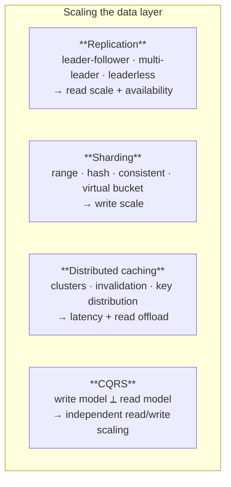
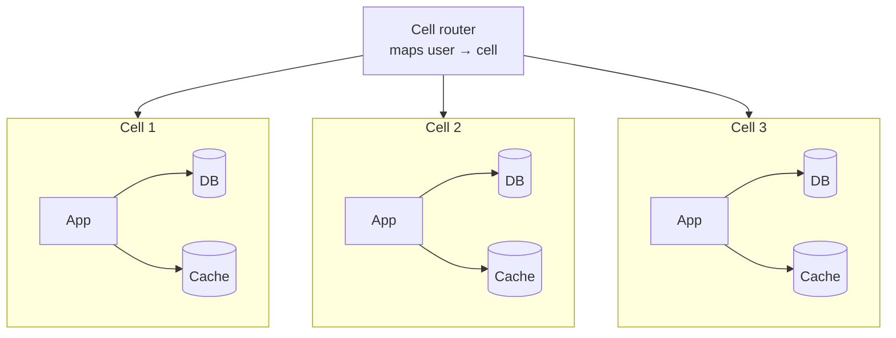
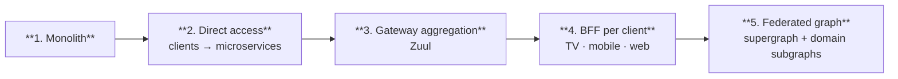

# Level 3 — Hyperscale

**Optimise for scale and organisational scale simultaneously.** At this level two constraints bind at
once: no single machine holds the data or the traffic, and no single team can own the system. Most L3
architecture is really about the second constraint — Conway's Law with a budget.

**Rough shape:** >10M users, >10K sustained QPS, TB–PB of data, 50+ engineers across many teams,
99.99%+ availability (8.64 s/day), multi-region, downtime makes the news.

**Prerequisite:** every rung of the L2 ladder is exhausted and *measured*. Reddit serves a billion
users a month on Postgres with memcached in front. Discord ran on a single MongoDB replica until 100
million messages. The threshold is much higher than it feels.

---

## 1. Partitioning the data layer

Four levers, applied in this order of preference. Full detail in `06-data-layer.md`.

### Sharding — the irreversible decision

**Algorithms**

| Algorithm | Property | Trade-off |
|---|---|---|
| **Range-based** | Split on value ranges | Range scans stay local; severe skew and recent-data hotspots |
| **Hash-based** | Hash the shard key | Even distribution; kills range queries, resharding moves everything |
| **Consistent hashing** | Keys and nodes on a ring | **The standard choice** — adding/removing a shard moves only ~1/N of keys |
| **Virtual bucket** | Keys → many buckets → physical shards | Rebalancing becomes a metadata operation. Choose this if shard count will change |
| **Directory-based** | A lookup table records placement | Maximum flexibility; the lookup service becomes critical infrastructure |

**Choosing the shard key** — three properties, all of which must hold:

- **Cardinality** — must be high. A key with five values gives five shards forever.
- **Frequency** — an evenly distributed key with one very popular value still produces a hotspot.
  Inspect the actual distribution, not the domain.
- **Monotonic change** — a monotonically increasing key (timestamp, auto-increment ID) sends every
  new write to the newest shard. Prefix with a hash, or shard on something else.

**Request routing** — shard-aware node (any node serves or redirects) · routing tier (a proxy owns
the mapping — Figma's DBProxy, Vitess) · shard-aware client (fastest, most coupled).

**What sharding costs, permanently:** no cross-shard joins · no cross-shard transactions (you need
sagas) · unique constraints become application logic · resharding is a project · every future
feature must answer "which shard?"

This is why it is the last rung.

### CQRS

Separate the write model from the read model so each scales and is optimised independently. The read
side is a projection updated asynchronously — which means **reads are eventually consistent and the
UI must be designed for it**, or read-your-own-writes must come from the write side.

Adopt when read and write workloads have genuinely divergent shapes and volumes. Not as a default
layering.

### Event sourcing

Persist state changes as an append-only log; the event store is the source of truth, current state
is a projection. Buys perfect audit, temporal queries, and the ability to build new read models from
history.

Costs: event schema evolution is forever, replays get slow (needs snapshots), and every developer
must think in events. Adopt only when the audit or replay requirement is real and stated.

---

## 2. Multi-region

Pick from stated RTO/RPO and data-residency law, not ambition:

| Strategy | RTO | RPO | Cost | Notes |
|---|---|---|---|---|
| **Backup & restore** | hours–days | to last backup | lowest | Not an L3 answer |
| **Pilot light** | minutes–hours | sync frequency | low | Core data replicated, minimal infra idle |
| **Warm standby** | minutes | minutes | medium | Scaled-down full copy running |
| **Hot site / active-active** | ~immediate | seconds | highest | Full traffic in multiple regions |

**Active-active is where conflict resolution stops being theoretical.** You need a merge strategy —
last-write-wins, CRDTs, or single-writer-per-partition — decided **per data type** before you build
it.

Most organisations that say "active-active" want "active-passive with fast failover" and should say
so. The honest question is: *when two regions accept a write to the same record simultaneously, what
is the correct answer?* If nobody can state it per entity, you are not ready for active-active.

**Also required at this level**

- **GSLB / anycast routing** to steer users to the nearest healthy region
- A deliberate answer for **in-flight writes during a regional failover**
- **Data residency** enforcement where law requires it — which may mean per-region data stores that
  never replicate

---

## 3. Cell-based architecture

The pattern the largest systems converge on. Partition the **entire stack** — not just the database —
into independent **cells**, each serving a fixed slice of users, each a complete copy of the system.

**What it buys**

- A failure is contained to one cell instead of taking down everything
- Deploys roll cell by cell, so a bad release has a bounded blast radius
- Load testing one cell tells you the capacity of the system
- **Shuffle sharding** — assigning each customer a random *combination* of cells — means a single
  noisy tenant degrades a small, mostly disjoint set of neighbours rather than everyone

**What it costs** — N copies of everything; cross-cell operations become distributed problems;
routing and migration between cells is new infrastructure you own; and "which cell is this customer
in?" becomes a question every tool must answer.

---

## 4. The API layer at organisational scale

The recurring evolution. **Netflix and Reddit independently walked the same path:**

**Gateway aggregation** — one screen needs data from dozens of services; a client cannot make dozens
of calls. Netflix's LOLOMO screen fetched from tens of microservices, and making those calls from
the client was a performance problem.

**BFF (Backend for Frontend)** — TV, mobile, and web have genuinely different needs, so each gets a
dedicated backend doing its own fan-out and orchestration. Netflix built these in Groovy + RxJava,
and **moved away from them because reactive programming was too hard for the team** — a legitimate
architectural constraint.

**GraphQL Federation** — one supergraph; each domain team owns a subgraph (a Domain Graph Service).
This solves the **ownership** problem: teams ship schema independently without a central API team
becoming the bottleneck. That, not query flexibility, is why large organisations adopt it.

---

## 5. Streaming backbone

At L3 the message bus becomes infrastructure that other infrastructure depends on.

**Why Kafka is fast** — two decisions carry the weight:

1. **Sequential I/O** — append-only log, no random seeks. The log structure *is* the performance feature.
2. **Zero copy** — `sendfile()` moves data from the OS page cache straight to the network card,
   skipping copies through application memory and the socket buffer. Four copies become two.

**Uses at this level** — log aggregation · CDC pipelines · recommendation and feature streams ·
monitoring and alerting · system migration (dual-write, verify, cut over).

**Message loss is a configuration property, not a guarantee.** Producer (`acks`, `retries`,
record accumulator), broker (async disk flush, replica configuration), and consumer (auto-commit
acknowledging before processing) each have loss modes. See `09-messaging-and-events.md` §4.

**Operational requirements the moment it is shared infrastructure:** a schema registry, topic naming
and ownership conventions, retention policy per topic, consumer lag alerting, and a documented
contract for every event type.

---

## 6. Reliability engineering at L3

- **Chaos engineering** — Netflix's Chaos Monkey terminates instances in production continuously,
  because untested failover does not work. The point is to find the failure on a Tuesday afternoon
  rather than during a launch.
- **Load shedding** — when saturated, reject cheaply and early at the edge. A fast 503 to 10% of
  traffic beats a slow collapse for 100%.
- **Backpressure everywhere** — bounded queues, rate limits, admission control. Unbounded buffering
  converts a latency problem into an outage.
- **Hedged requests** — for p99 tail latency, issue a duplicate after a short delay and take the
  first response. A few percent extra traffic for a sharply reduced tail. Essential when a single
  page fans out to many services.
- **Heartbeats and failure detection** — push, pull, health-check-carrying, timestamped,
  acknowledged, or **quorum-based** (Raft/Paxos). Quorum matters once membership changes are
  frequent. The real danger is false positives causing split-brain.
- **Error budgets** — 99.99% is a budget of 8.64 seconds a day. Spend it deliberately on releases;
  when exhausted, feature work stops. This is what makes an availability target a real constraint
  rather than a slogan.
- **Game days** — rehearse regional failover with the people who would actually run it.

---

## 7. Cost as an architectural constraint

At this scale cost stops being a finance concern. The levers:

- Right-sizing and terminating idle resources
- Scheduled shutdown of non-production environments
- Reserved instances and savings plans for steady workloads; spot for interruptible work
- Tiered storage — hot, cool, archive
- **Data transfer, usually the biggest line** — attacked with compression, CDN offload, and keeping
  traffic **intra-region**
- **Runtime efficiency** — Netflix's Java 8 → 17 migration returned **20% CPU across the fleet**,
  which is why runtime upgrades are architecture work at this level

A 5% efficiency gain at L3 is a headcount.

---

## 8. Organisational architecture

The part that is genuinely different at L3, and the part most often omitted from design documents:

- **Service ownership** — every service has a named owning team, an on-call rotation, and an SLO.
  Unowned services are how outages become unassignable.
- **Platform team** — the nine microservice platform components become a product with internal
  customers, not a side project.
- **Paved road** — one supported way to build a service, with templates, libraries, and CI baked in.
  Teams may go off-road, but then they own everything themselves.
- **API contracts as the coordination mechanism** — schema registries, consumer-driven contract
  tests, and deprecation policies with dates. This is what replaces meetings.
- **Conway's Law, used deliberately** — service boundaries will match team boundaries whether you
  plan it or not, so plan it.

---

## 9. The honest caveat

Almost nothing needs L3, and the systems that do arrived there gradually, under measurement, one
forced move at a time. From `14-case-studies.md`:

- **Discord** replaced its database twice, over ten years, each time because a specific metric
  became untenable — RAM exhaustion at 100M messages, then GC pauses and LSM read amplification at
  177 nodes.
- **Figma** reached 100× Postgres growth before horizontal partitioning, and the triggers were
  concrete: Vacuum behaviour and an RDS IOPS ceiling.
- **Reddit** serves over a billion users a month on Postgres with memcached in front.
- **Stack Overflow** never left the monolith — nine on-premise web servers.

**The failure mode of this level is not being unable to build it. It is building it in year one**,
and spending the company's entire engineering budget operating a system for a load that never
arrives.

If you are reading this document for a system that has not yet exhausted `02-level-2-production.md`,
go back.

---

## 10. The right question

When designing at this level, the question is never *"how would Netflix build this?"*

It is **"what did Netflix look like when they had our traffic?"** — and the answer is almost always:
a monolith with one database.
