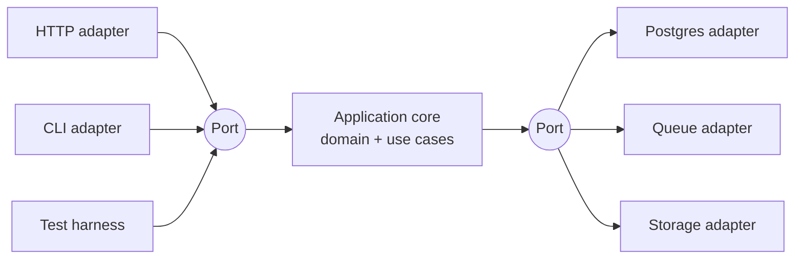
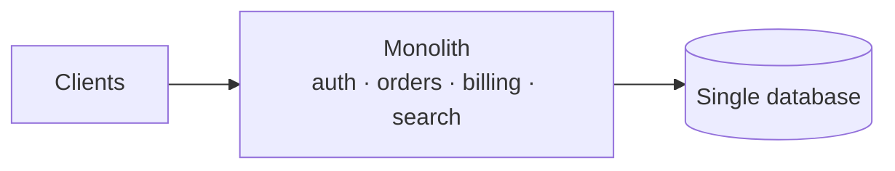
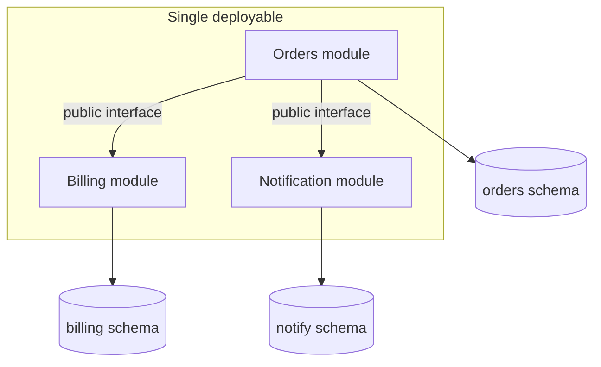
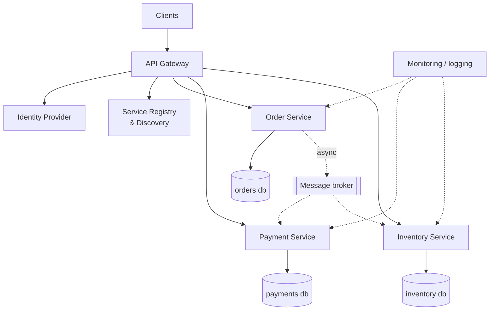
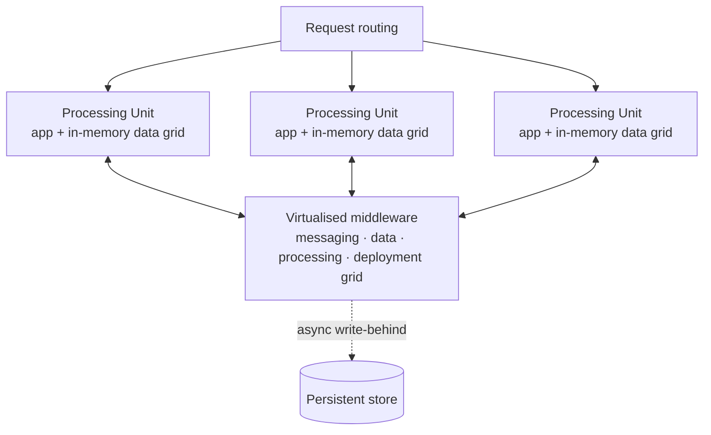
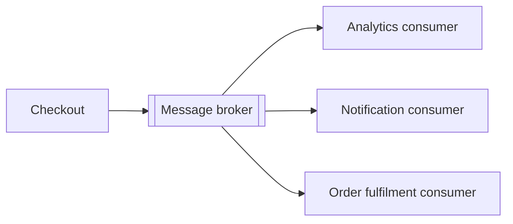
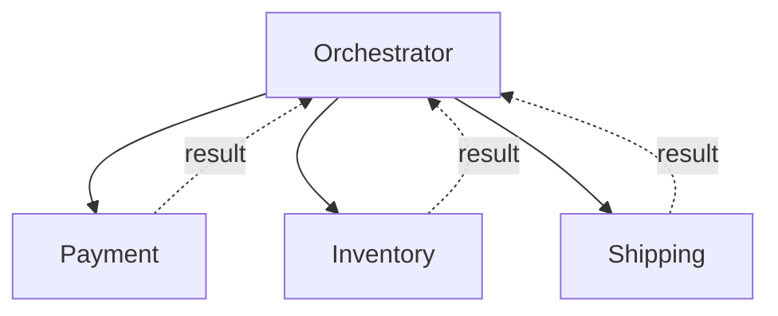
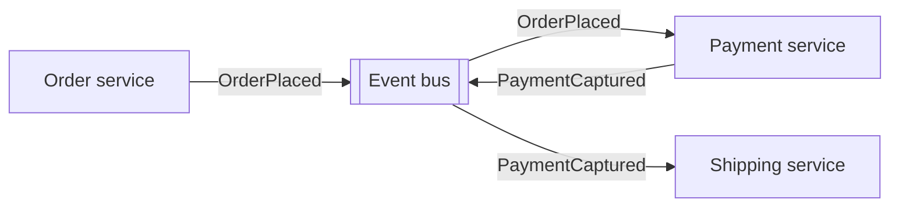
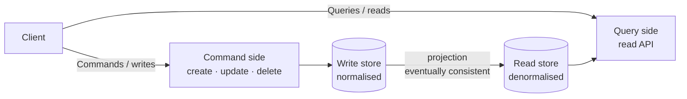
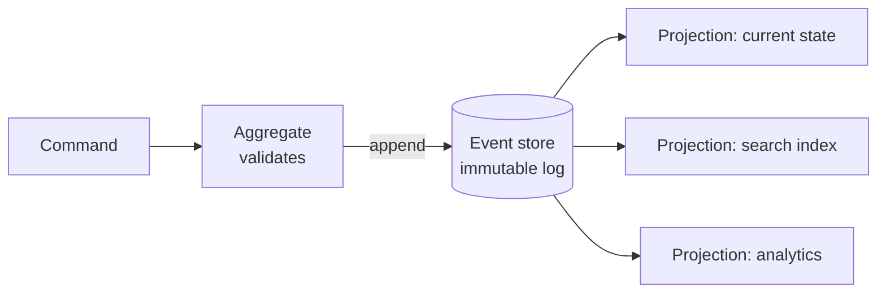

# Architecture Patterns and Styles

The full catalogue, so a style is *chosen* rather than defaulted into. Each entry: what it is, when
it earns its place, what it costs, and which level it belongs to.

---

## 1. Structural styles

### Layered (n-tier)

Separates software into logical layers, each depending only on the one below.

```
┌─────────────────────────┐
│   Presentation Layer    │  controllers, routes, DTOs
├─────────────────────────┤
│    Business Layer       │  services, domain rules
├─────────────────────────┤
│   Persistence Layer     │  repositories, queries
├─────────────────────────┤
│    Database Layer       │
└─────────────────────────┘
```

**Use when** — almost always, as the internal structure of any single deployable. This is the
default shape of an L1 app and the inside of an L2 modular monolith.

**Costs** — a change to one feature often touches every layer ("sinkhole" anti-pattern when layers
just pass calls through). Layers can hide the domain.

**Level** — L1, L2.

### Clean / Onion Architecture

Dependencies point inward, toward the domain. The domain knows nothing about the database, the web
framework, or the outside world.

```
        ┌──────────────────────────────┐
        │  Frameworks & Drivers        │  web, DB, devices
        │   ┌────────────────────────┐ │
        │   │  Interface Adapters    │ │  controllers, gateways, presenters
        │   │   ┌──────────────────┐ │ │
        │   │   │  Use Cases       │ │ │  application business rules
        │   │   │  ┌────────────┐  │ │ │
        │   │   │  │  Entities  │  │ │ │  enterprise business rules
        │   │   │  └────────────┘  │ │ │
        │   │   └──────────────────┘ │ │
        │   └────────────────────────┘ │
        └──────────────────────────────┘
              dependencies point ──►  inward only
```

**Use when** — the domain logic is genuinely complex and long-lived, and you expect infrastructure
to change (swap ORM, swap message broker, expose the same logic via API and CLI).

**Costs** — a lot of interfaces and mapping code. On a CRUD app it is pure ceremony.

**Level** — L2 when the domain is rich; overkill at L1.

### Hexagonal (Ports and Adapters)

The same inversion expressed differently: the application core defines **ports** (interfaces), and
**adapters** implement them on the outside. Driving adapters (HTTP, CLI, tests) call in; driven
adapters (Postgres, Kafka, S3) are called out.



**Use when** — you want the core testable without any infrastructure, or you genuinely have multiple
drivers and multiple implementations of the same port.

**Costs** — indirection; a junior reading the code cannot follow a request by grepping.

**Level** — L2, L3.

### Microkernel (Plug-in)

A minimal functional core plus extensions that add customer-specific or optional behaviour.

```
      ┌────────┐ ┌────────┐ ┌────────┐
      │Plug-in │ │Plug-in │ │Plug-in │
      └───┬────┘ └───┬────┘ └───┬────┘
          └──────────┼──────────┘
                ┌────▼─────┐
                │   Core   │   registry + contracts
                │  System  │
                └──────────┘
```

**Use when** — product needs per-customer variation without forking (IDEs, browsers, ETL tools,
workflow engines, rules engines).

**Costs** — the plug-in contract is a public API you can never break. Versioning becomes hard.

**Level** — L2, L3 for platform products.

### Component-Based

The system is assembled from independently replaceable components with well-defined interfaces,
inside one deployable.

**Use when** — you want microservice-like boundaries without microservice operations. This is the
mechanism behind a **modular monolith** and the correct default for L2.

---

## 2. Distribution styles

### Monolith

One deployable, one database, one release.



**Use when** — one team, or several teams that can coordinate a release. Transactions across the
whole domain, refactoring across boundaries, one thing to deploy and monitor.

**Costs** — one scaling profile for everything; a memory leak in reporting takes down checkout;
release coordination becomes the bottleneck as headcount grows.

**Level** — L1 always; L2 by default. Stack Overflow runs global traffic on a monolith across nine
on-prem web servers — the ceiling is far higher than the discourse suggests.

### Modular Monolith

One deployable, hard internal module boundaries, one database with per-module schema ownership and
**no cross-module table access**.



**Use when** — L2 default. You get the seams for a future split without paying distributed costs today.

**Costs** — boundaries must be enforced (module tests, lint rules, package visibility) or they rot.

### Service-Oriented Architecture (SOA)

Coarse-grained services sharing an enterprise service bus and often a shared data layer.

**Use when** — mostly historical; relevant when integrating heterogeneous enterprise systems.

**Costs** — the bus becomes a central bottleneck and a place for business logic to hide.

### Microservices

An application as a suite of independently deployable, small, modular services — each owning its
own data.



**Use when** — a specific trigger fires: independent deploy pressure between teams, divergent
scaling profiles, divergent runtimes (GPU, another language), fault isolation of a flaky
dependency, or a compliance blast-radius boundary.

**Costs** — the complete list, because it is routinely understated: distributed transactions become
sagas, joins become API calls or duplication, debugging requires distributed tracing, every call
needs a timeout/retry/circuit breaker, every consumer needs idempotency, deployment needs
orchestration, and you now operate nine platform components (gateway, registry, authz server,
storage, cache, broker, metrics, logs, tracing).

**Never** share a database between services — that is a distributed monolith, which has all of the
costs and none of the benefits.

**Level** — L2 only on trigger; L3 typically.

### Serverless (FaaS / PaaS)

Functions or managed containers with no server management and scale-to-zero.

**Use when** — spiky or infrequent workloads, glue and event handlers, cron jobs, low ops appetite.

**Costs** — cold starts, execution time limits, vendor lock-in, hard local testing, and cost that
becomes worse than instances under sustained high traffic.

### Space-Based

Removes the central database from the request path. Processing units hold data in an in-memory data
grid, replicated between units; a virtualised middleware layer handles messaging, data replication,
processing distribution, and deployment. Persistence happens asynchronously behind the grid.



**Use when** — extreme, spiky concurrency where the database is the unavoidable bottleneck
(ticketing, trading, betting, auctions).

**Costs** — very high complexity; in-memory data consistency and grid failure handling become your
problem.

**Level** — L3, narrow.

### Peer-to-Peer

Direct communication between components with no central coordinator.

**Use when** — content distribution, blockchain, service meshes at the data plane, WebRTC media.

**Costs** — discovery, trust, consistency, and NAT traversal all become hard.

### Broker

Components communicate through a broker that handles discovery and routing rather than addressing
each other directly.

**Use when** — many-to-many communication where endpoints change frequently.

---

## 3. Data and flow styles

### Event-Driven Architecture

Promotes the production, detection, consumption of, and reaction to events.



**Use when** — one action must trigger many independent reactions, and the producer should not know
or care who reacts. Adding a consumer becomes a deploy of that consumer only.

**Costs** — eventual consistency, no global ordering guarantee, harder end-to-end debugging,
mandatory idempotency, and "what actually happens when a user clicks buy?" becomes an archaeology
exercise without tracing.

### Publish-Subscribe

Decouples publishers from subscribers through a broker with topic-based fan-out. The messaging
mechanism underneath most event-driven systems.

### Pipeline / Pipe-Filter

Data flows through a chain of independent transformation stages. Each filter does one thing and is
independently testable and replaceable.

```
Source ──► [Parse] ──► [Validate] ──► [Enrich] ──► [Aggregate] ──► Sink
```

**Use when** — ETL, log processing, media transcoding, compilers, data ingestion.

### Orchestration vs Choreography

The single most consequential coordination decision in a distributed system.

**Orchestration** — a central coordinator directs the interaction between services and owns both
control flow and data flow.



*Pros:* the business process exists in one readable place; easy to debug, monitor, and change;
compensation logic is centralised. *Cons:* the orchestrator is coupled to everyone and can become a
bottleneck and a single point of failure.

**Choreography** — no coordinator; each service reacts to events and emits its own.



*Pros:* minimal coupling, teams add reactions without touching anyone else. *Cons:* the process
exists nowhere — you cannot read it, only reconstruct it from traces. Cyclic event chains and
unintended cascades are real failure modes.

**Rule of thumb:** orchestrate business transactions that need compensation (payments, ordering);
choreograph notifications and side effects (email, analytics, indexing).

### Lambda vs Kappa

**Lambda** — a batch layer for accuracy and completeness plus a speed layer for freshness, merged
at query time. Costs: two implementations of the same logic, forever.

**Kappa** — stream only; reprocess history by replaying the log. Simpler, at the cost of requiring
a replayable log and enough retention.

### Data-Centric

The database is the integration point between components. Common in legacy and analytics estates.
Costs: the schema becomes an undocumented public API that nobody can change.

---

## 4. Read/write separation styles

### CQRS (Command Query Responsibility Segregation)

Separates the model used to write from the model used to read, so each is optimised and scaled
independently.



**Use when** — read and write workloads have genuinely different shapes and volumes (100:1 read
ratios, complex reporting reads over simple transactional writes).

**Costs** — two models to maintain, a projection pipeline to operate, and **reads are eventually
consistent** — the UI must be designed for it ("your change may take a moment to appear"), or you
must read-your-own-writes from the write side.

**Level** — L3, or L2 for one specific hot read path.

### Event Sourcing

Changes the paradigm from persisting *state* to persisting *events*. The event store is the source
of truth; current state is a fold over the event log.



**Three real-world shapes from the source material:**

1. **New York Times** — every article, image, and byline since 1851 lives in an event store; the raw
   data is denormalised into different views and fed into Elasticsearch nodes for site search.
2. **Change Data Capture** — a CDC connector reads the database transaction log, turns changes into
   events, and pushes them to Kafka where other sinks consume them.
3. **Microservice connector** — the shopping cart service emits add/remove events; fraud, billing,
   and email services each consume them and derive their own domain model.

**Use when** — audit trail is a hard requirement, temporal queries ("what did this look like on
March 3rd?") are needed, or you must be able to build new read models from history.

**Costs** — event schema evolution is permanent, replays get slow as the log grows (needs
snapshots), and every developer must think in events. Do not adopt for the aesthetics.

---

## 5. Presentation patterns

**MVC** — Model (data), View (display), Controller (translates input into model operations). ~50
years old and still the default for server-rendered web.

**MVP** — the Presenter mediates and holds the presentation logic; the View is passive and easy to
test.

**MVVM** — a ViewModel exposes bindable state; the View binds declaratively. Native to WPF, Android,
and modern reactive frontends.

**MVVM-C / VIPER** — add an explicit Coordinator/Router for navigation, splitting responsibility
further. Common in large iOS codebases.

The pattern across all of these: a **translator** (controller / presenter / view-model) sits between
display and data. The variants exist because that translator is where complexity accumulates.

---

## 6. Choosing a style

| Situation | Style |
|---|---|
| Prototype, one team | Layered monolith |
| Production app, one to three teams | Modular monolith (component-based + DDD boundaries) |
| Rich, long-lived domain logic | Clean / Hexagonal inside the monolith |
| Product needing per-customer extension | Microkernel / plug-in |
| Independent deploy or scaling pressure per team | Microservices |
| One action, many independent reactions | Event-driven + pub/sub |
| Business transaction across services needing compensation | Orchestration + saga |
| Notifications, analytics, indexing side effects | Choreography |
| 100:1 read/write ratio with different shapes | CQRS |
| Hard audit / temporal query requirement | Event sourcing |
| Spiky, infrequent workload | Serverless |
| The database is an unavoidable bottleneck at extreme concurrency | Space-based |
| ETL / transcoding / ingestion | Pipeline |

Styles compose. A realistic L3 system is microservices (distribution) + hexagonal inside each
service (structure) + event-driven between them (flow) + CQRS on the two hottest read paths + saga
for checkout. Naming all four layers of that choice is what a good design document does.
