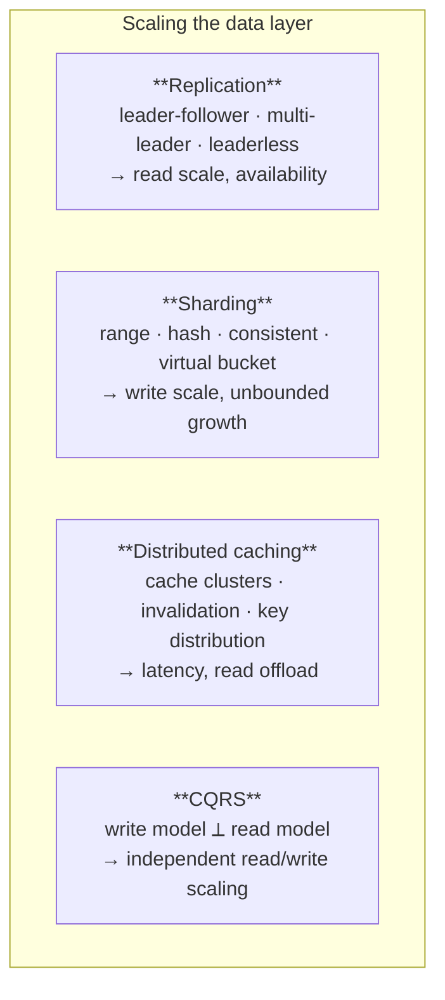
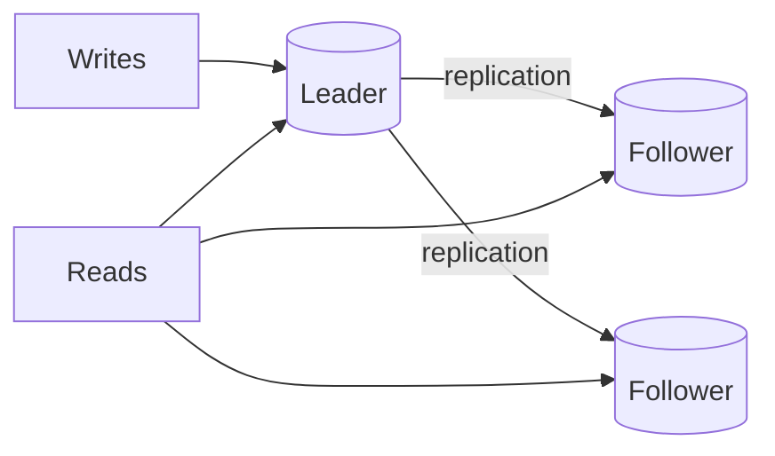
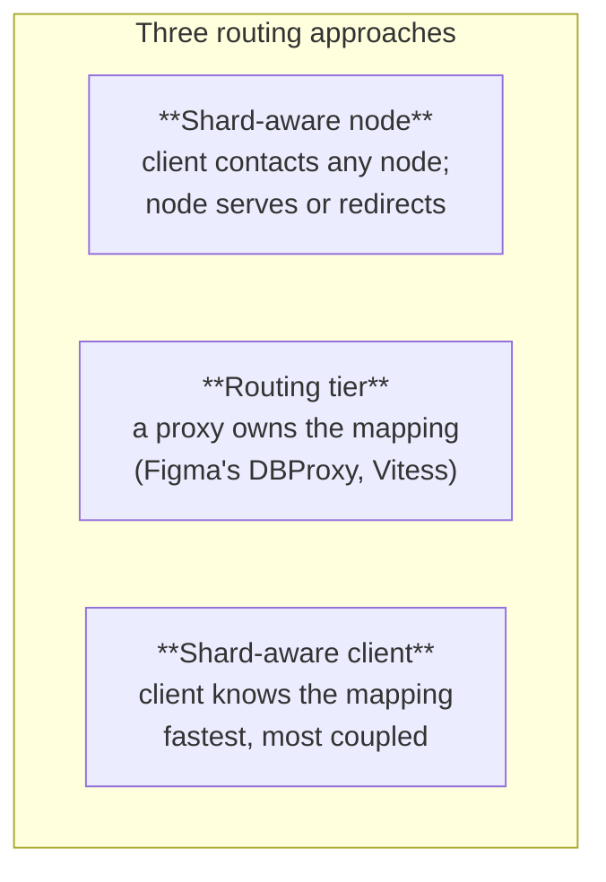
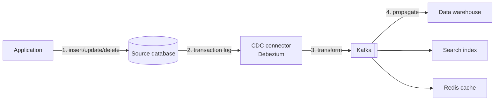

# The Data Layer

The data layer is where system design decisions become permanent. Application code is rewritten;
a shard key is not.

## 1. The four levers

They compose, and they are applied in that order of preference. Replication is cheap and reversible;
sharding is expensive and permanent.

---

## 2. Choosing a database

| Type | Pick when | Examples |
|---|---|---|
| **Relational** | Default. Transactions, joins, constraints, mature tooling | PostgreSQL, MySQL |
| **Document** | Nested/flexible schemas; the document is the unit of work | MongoDB, Couchbase |
| **Key-value** | Cache, session, rate limit, leaderboard, queue (carefully) | Redis, Memcached |
| **Wide-column** | Very high write throughput, known query patterns, multi-region | Cassandra, ScyllaDB |
| **Search** | Full-text, faceting, relevance tuning, log analytics | Elasticsearch, Azure AI Search |
| **Vector** | Embedding similarity for RAG | pgvector, Azure AI Search, FAISS |
| **Graph** | Relationship traversal is the primary access pattern | Neo4j, Apache AGE |
| **Time-series** | Append-heavy, time-windowed queries, downsampling | TimescaleDB, InfluxDB |
| **Object storage** | Files, media, backups, data lake | S3, Azure Blob |

### Start with PostgreSQL and stay longer than feels fashionable

Postgres now covers most of the specialist column above through extensions:

- **Time-series** → TimescaleDB
- **Vector / ML** → pgvector, PostgresML
- **Geospatial** → PostGIS
- **Full-text search** → built-in, plus pgroonga / ParadeDB / ZomboDB
- **OLAP** → Citus, Hydra, pg_analytics
- **Graph** → Apache AGE; `pg_graphql` for a GraphQL interface
- **Federated queries** → foreign data wrappers to MongoDB, MySQL, Redis, Oracle, SQLite, Parquet
- **Derived engines** speaking Postgres protocol → CockroachDB, AlloyDB, YugabyteDB, Supabase, Neon

**Rules of thumb**

- Never add a second database to solve a problem an index would fix.
- Model around **query patterns**, not entities. Write the queries down before choosing the store.
- Every additional datastore is another thing to back up, monitor, secure, upgrade, and staff.

### Top open-source databases by adoption

MySQL · PostgreSQL · MariaDB · Cassandra · Neo4j · SQLite · CockroachDB · Redis · MongoDB · Couchbase

---

## 3. Data models

- **Flat** — a single table, spreadsheet-like. Simple; cannot express relationships.
- **Hierarchical** — tree; each record has one parent, many children. Efficient for true
  parent-child; fails on many-to-many and becomes rigid.
- **Relational** (Codd, 1970) — tables of rows and columns, integrity through keys and
  normalisation. Handles many-to-many, supports complex queries and transactions. The default.
- **Network** — records may have multiple parents and children, forming a graph. Handles
  many-to-many that the hierarchical model cannot.
- **Star schema** — a central fact table surrounded by dimension tables. Built for OLAP: minimises
  joins, fast analytical reads.
- **Snowflake** — star schema with normalised dimensions. Less redundancy and better integrity, more
  joins and slower queries.

---

## 4. Relational design essentials

**Keys**

- **Primary key** — column(s) uniquely identifying each row.
- **Surrogate key** — system-generated identifier with no business meaning (serial, UUID). Preferred
  for stability: business identifiers change.
- **Foreign key** — a reference to another table's primary key. Enforce them; a "we'll handle it in
  the application" referential integrity policy has never once worked.

**Relationships** — one-to-one, one-to-many, many-to-many (needs a join table).

**Joins** — inner, left outer, right outer. If a query needs a full outer join, the model is usually
wrong.

**Normalisation vs denormalisation** — normalise by default so each fact is stored once; denormalise
a specific hot read path deliberately, and write down that you did.

### How a SQL query actually executes

1. Parse the statement and validate syntax and references
2. Transform it into an internal representation (relational algebra)
3. Optimise that representation and build an execution plan using index statistics
4. Execute the plan and return results

This is why `EXPLAIN ANALYZE` is the first tool for any slow query — you are inspecting step 3, and
step 3 is where nearly all "the database is slow" problems live.

**SQL sub-languages** — DDL (`CREATE`/`ALTER`/`DROP`) · DQL (`SELECT`) · DML
(`INSERT`/`UPDATE`/`DELETE`) · DCL (`GRANT`/`REVOKE`) · TCL (`COMMIT`/`ROLLBACK`).

---

## 5. Storage engines and data structures

The engine choice becomes architecture at scale.

| Structure | Property | Used by |
|---|---|---|
| **B-tree** | Disk-based, consistent read *and* write performance | PostgreSQL, MySQL InnoDB |
| **LSM tree** | Skiplist (memory) + SSTables (disk). Very high write throughput, reads more expensive | Cassandra, RocksDB, ScyllaDB |
| **Skiplist** | Common in-memory index | Redis |
| **SSTable** | Immutable on-disk sorted map | LSM engines |
| **Hash index** | O(1) point lookup, no range scans | Redis, in-memory maps |
| **Inverted index** | Term → document list; the core of full-text search | Lucene, Elasticsearch |
| **Suffix tree** | Substring pattern search | Text search engines |
| **R-tree** | Multi-dimensional / nearest-neighbour search | PostGIS, spatial indexes |
| **Bloom filter** | Probabilistic "definitely not present" | Cache penetration defence, LSM read paths |

**Why this matters:** an LSM tree trades read amplification for write throughput. On a workload with
hundreds of concurrent readers per partition, that trade inverts and you get hotspots plus
compaction pauses — exactly the wall Discord hit with Cassandra (see `14-case-studies.md`).

**Bloom filters** deserve special mention: they answer "is this key definitely absent?" in constant
space, which is the standard defence against cache penetration and the reason LSM reads are
tolerable at all.

---

## 6. Transactions

### ACID

- **Atomicity** — all writes in a transaction succeed or none do; faults roll back.
- **Consistency** — database invariants are preserved. *Not the same C as in CAP.*
- **Isolation** — concurrent transactions do not observe each other's partial state. Serializability
  is strictest (each transaction behaves as if alone) and is rarely used because it is expensive.
- **Durability** — committed data survives failure; in a distributed system, this means replicated
  to other nodes.

### BASE

**B**asically **A**vailable, **S**oft state, **E**ventually consistent — the NoSQL relaxation that
chooses availability over immediate consistency.

### CAP

Under a network partition, choose consistency or availability. Useful as a teaching device, but do
**not** classify databases as "CP" or "AP": real systems tune per operation, and partitions are
guaranteed in any distributed system, so the trade is never avoidable. (See Kleppmann, *Please stop
calling databases CP or AP.*)

---

## 7. Locks and deadlocks

**Lock types**

| Lock | Behaviour |
|---|---|
| **Shared (S)** | Many readers concurrently; no writer |
| **Exclusive (X)** | One transaction reads and writes; no other lock permitted |
| **Update (U)** | Held while deciding to update; prevents a common deadlock shape |
| **Schema** | Protects object structure during DDL |
| **Bulk update (BU)** | Reduces lock count during bulk inserts |
| **Key-range** | Prevents phantom reads over an indexed range |
| **Row-level** | Locks one row; maximum concurrency |
| **Page-level** | Locks a fixed-size block |
| **Table-level** | Locks everything; simple, destroys concurrency |

**Deadlock** — two or more transactions each wait for locks the other holds, forever.

**Coffman conditions** — all four must hold simultaneously for deadlock to be possible:

1. Mutual exclusion
2. Hold and wait
3. No preemption
4. Circular wait

**Prevention** — impose a total ordering on resource types and require acquisition in increasing
order (breaks circular wait); timeouts that roll back long holders; Banker's algorithm to refuse
allocations that would reach an unsafe state.

**Recovery** — the DBMS detects the cycle, selects a victim (by resource use, priority, or rollback
cost) and rolls it back. Applications must therefore be prepared to **retry on deadlock** — it is a
normal condition, not an exception.

---

## 8. Replication

**Leader-follower (single leader)** — one node accepts writes and replicates to followers; followers
serve reads.

Simple and the default. **Replication lag is a correctness concern**: decide per query whether it
tolerates staleness, and keep read-your-own-writes on the leader.

**Multi-leader** — several nodes accept writes and replicate to each other. Needed for multi-region
write locality and offline-capable clients; requires conflict resolution.

**Leaderless** — any node accepts writes, which propagate to others. Reads and writes use quorums:
as long as **W + R > N**, a read is guaranteed to see the latest write. Adds hinted handoff (store
writes for a down node) and Merkle trees (efficiently find divergence between replicas). This is
Dynamo/Cassandra's model.

---

## 9. Sharding

Splitting one large database into smaller, independently hosted pieces. Buys scalability, improved
performance, and better availability — at permanent cost.

### Algorithms

**Range-based** — partition on value ranges (dates, last names).
*Pro:* range scans stay on one shard. *Con:* severe skew; recent-data hotspots.

**Hash-based** — apply a hash function to the shard key.
*Pro:* even distribution. *Con:* range queries fan out to all shards; adding a shard rehashes almost
everything.

**Consistent hashing** — keys and nodes placed on a hash ring; a key belongs to the next node
clockwise.
*Pro:* adding or removing a shard relocates only ~1/N of keys. The standard choice.

**Virtual bucket** — keys map to many virtual buckets; buckets map to physical shards.
*Pro:* rebalancing becomes a metadata operation, not a data migration. Choose this if the shard count
will change.

**Directory-based** — a lookup table records where each record lives. Maximum flexibility; the
lookup service becomes a critical dependency and a bottleneck.

### Choosing the shard key — the irreversible decision

- **Cardinality** — the number of distinct values. Must be high; a key with five values gives five
  shards forever.
- **Frequency** — how often each value appears. An evenly distributed key with one very popular
  value still produces a hotspot. Inspect the actual distribution, not the domain.
- **Monotonic change** — a monotonically increasing key (timestamp, auto-increment ID) sends every
  new write to the newest shard. Prefix with a hash, or shard on something else.

### Request routing

### What sharding costs, permanently

- No cross-shard joins
- No cross-shard transactions (you need sagas)
- Unique constraints become application logic
- Resharding is a project, not a task
- Every future feature must answer "which shard?"

This is why it is the last rung of the ladder.

---

## 10. Data management patterns

**Cache-aside** — the application checks the cache; on a miss it reads the store, populates the
cache, and returns. Best for read-frequently, update-rarely data. The default.

**Materialised view** — a query result physically stored and refreshed. Turns an expensive
aggregation into a cheap read. Ideal for warehousing and dashboards; costs staleness and refresh
cost.

**CQRS** — separate read and write models; see `05-architecture-patterns.md`.

**Event sourcing** — persist the change log rather than current state; see `05-architecture-patterns.md`.

**Index table** — additional tables acting as secondary indexes optimised for specific queries,
avoiding full scans of the primary store. Useful when the primary store cannot index the way you
need (common in NoSQL).

**Sharding** — as above.

---

## 11. Change Data Capture (CDC)

CDC identifies and captures changes made to data in a database so they can be replicated and synced
elsewhere in real time. It solves the "databases, data lakes, and warehouses are constantly out of
sync" problem without dual writes.

1. **Data modification** — an insert, update, or delete on the source
2. **Change capture** — the CDC tool reads the *transaction log* (not the tables), via a source connector
3. **Change processing** — changes are transformed into a downstream-friendly format
4. **Change propagation** — published to a broker and fanned out to targets
5. **Real-time integration** — sink connectors apply changes to warehouses, analytics, caches

**The standard stack is Debezium + Kafka Connect**, with connectors for MySQL, PostgreSQL, Oracle,
SQL Server, and MongoDB. The application only performs step 1; everything else is transparent to it.

**Why it matters:** reading the transaction log means no dual-write consistency problem, no
application changes, and no polling load on the source. Reddit uses exactly this to maintain cache
consistency and data replication.

---

## 12. The database scaling ladder

Climb in order. Each rung is cheaper and less invasive than the next.

| # | Rung | What it buys | Cost |
|---|---|---|---|
| 1 | **Indexing** | Usually 10–1000× on the offending query | None. Read the query plans |
| 2 | **Fix N+1 / chatty ORM** | Often bigger than the index | None |
| 3 | **Materialised views** | Expensive aggregations become cheap | Staleness, refresh cost |
| 4 | **Denormalisation** | Removes joins from the hot read path | Write amplification, update anomalies |
| 5 | **Vertical scaling** | Frequently a year of headroom, one line of config | Ceiling, cost, still a SPOF |
| 6 | **Caching** | Removes most reads from the database | Invalidation, stampedes — see `07-caching.md` |
| 7 | **Read replicas** | Scales reads horizontally | Replication lag becomes a correctness issue |
| 8 | **Connection pooling** (PgBouncer) | Fixes exhaustion that looks like slowness | Transaction-mode caveats |
| 9 | **Vertical partitioning** | Move hot tables to their own database | Cross-database joins disappear |
| 10 | **Horizontal partitioning / sharding** | Unbounded write scale | Everything in §9 above |

Figma's actual path — documented in `14-case-studies.md` — was exactly rungs 5 → 7 → 8 → 9 → 10,
in that order, over 100× growth. That is the empirical argument for not skipping.

---

## 13. Seven strategies to scale a database (quick reference)

1. **Indexing** — match indexes to actual query patterns
2. **Materialised views** — precompute complex results
3. **Denormalisation** — reduce joins on hot paths
4. **Vertical scaling** — more CPU, RAM, storage
5. **Caching** — a faster layer in front
6. **Replication** — replicas scale reads and improve redundancy
7. **Sharding** — split tables across servers; scales writes as well as reads
