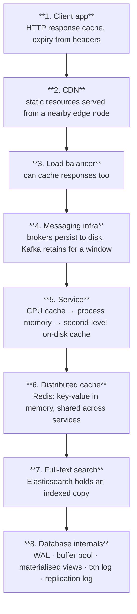

# Caching

Caching is the highest-leverage performance tool and the most common cause of production incidents
in mid-size systems. Both facts follow from the same property: a cache is a second copy of the truth.

## 1. Where data is cached — the full stack

Data is cached everywhere, front to back. Knowing every layer matters because "the user sees stale
data" can originate at any of them.

**Database-internal caches specifically:**

- **WAL (write-ahead log)** — data is written here before the B-tree index is built
- **Buffer pool** — memory region caching query results and pages
- **Materialised view** — precomputed query results stored as tables
- **Transaction log** — all transactions and updates
- **Replication log** — replication state across the cluster

**The operational consequence:** with data cached at eight layers, "delete this user's data" is a
distributed problem. Any GDPR/erasure design must enumerate every layer.

---

## 2. Caching strategies

| Strategy | How it works | Use when | Costs |
|---|---|---|---|
| **Cache-aside (lazy loading)** | App checks cache; on miss reads DB, populates cache, returns | **The default.** Simple, survives cache failure | Cold-start misses; possible staleness |
| **Read-through** | Cache library owns DB access; app only talks to the cache | Uniform access, simpler app code | Couples you to the cache layer; cold start |
| **Write-through** | Write to cache and DB synchronously | Cache must never be stale | Every write pays cache latency |
| **Write-behind (write-back)** | Write to cache, flush to DB asynchronously | Write-heavy, tolerant of loss | **Data loss window on crash** |
| **Write-around** | Write straight to DB, bypassing cache | Write-once-read-rarely data | First read is always a miss |
| **Refresh-ahead** | Refresh hot keys before they expire | Predictable hot keys, latency-critical | Wasted refreshes for unused keys |

**Cache-aside is the correct default at every level.** Its failure mode — a miss — is benign. The
others fail in ways that lose data or take the database down.

---

## 3. Eviction policies

- **LRU (Least Recently Used)** — evicts what has not been touched longest. Assumes recency predicts
  reuse. **The right default.**
- **LFU (Least Frequently Used)** — evicts by lowest access count. Better when popularity is stable;
  suffers from cache pollution by historically-popular-but-now-dead keys unless aged.
- **SLRU (Segmented LRU)** — two segments, probationary and protected. New entries land in
  probationary; a second hit promotes them to protected. Resists scan pollution, where one big scan
  flushes a good cache.
- **MRU (Most Recently Used)** — evicts the newest. Counterintuitive but correct when recent items
  are least likely to be needed again (e.g. sequential scans over a dataset larger than the cache).
- **FIFO** — evicts the oldest inserted, ignoring access patterns. Simple, generally worse than LRU.
- **TTL** — not strictly an eviction algorithm; each entry gets a lifespan. Composes with all of the
  above and is the main correctness control.
- **Random replacement** — evicts a random entry. Trivially cheap, no bookkeeping, surprisingly
  decent under uniform access.
- **Two-tiered caching** — an in-process L1 in front of a distributed L2. Cuts network hops for the
  hottest keys and is the standard defence against hot-key problems.

---

## 4. The four ways cache systems go wrong

This appears three separate times in the source material, which is a fair reflection of how often it
causes outages. Design for all four before you deploy a cache.

### 4.1 Thundering herd

**What happens:** a large number of keys expire at the same moment. Every request for them goes
straight to the database simultaneously, and the database falls over.

**Why it happens:** keys populated together (a deploy, a batch job, a cache warm) with an identical
TTL expire together.

**Mitigations:**
- **Jitter the TTL** — add a random offset so expiry spreads out. `ttl = base + random(0, base*0.1)`
- **Tiered protection** — allow only core business data to fall through to the database, and serve
  non-core data as degraded or unavailable until the cache recovers

### 4.2 Cache penetration

**What happens:** a key exists in neither the cache nor the database. Every request misses the cache,
queries the database, finds nothing, and caches nothing — so the next request repeats it. Pressure
lands on both layers. Often an attack vector: request random non-existent IDs in a loop.

**Mitigations:**
- **Cache the null** — store a negative result with a short TTL so the miss is absorbed
- **Bloom filter** — check key existence probabilistically before touching the database; if the
  filter says "definitely absent", return immediately

### 4.3 Cache breakdown (hot key expiry)

**What happens:** a *single* very hot key expires. Because hot keys can account for ~80% of queries,
a large fraction of all traffic hits the database in the same instant.

**Mitigations:**
- **Do not expire hot keys.** Refresh them out-of-band instead of relying on TTL
- **Single-flight / request coalescing** — the first miss recomputes; concurrent requests wait for
  that one result rather than all recomputing
- **Serve stale while revalidating** — return the expired value and refresh in the background
- **Local L1 cache** in front of Redis so the hot key is served from process memory

### 4.4 Cache crash

**What happens:** the cache goes down entirely and 100% of traffic hits the database, which was
never provisioned for it.

**Mitigations:**
- **Circuit breaker** — when the cache is down, the application stops trying both the cache *and*
  the database for non-critical paths, shedding load rather than collapsing
- **Cache cluster** — replication and failover so the cache itself is highly available
- **Capacity plan for partial cache loss** — know what fraction of full traffic the database can
  absorb, and shed the rest

---

## 5. Other failure modes to design for

**Hot key (without expiry)** — one key takes disproportionate traffic and saturates a single Redis
node. Mitigate with a local in-process cache, or key replication with a random suffix
(`user:123:r{1..N}`) and fan-out on read.

**Large key** — multi-megabyte values block the Redis event loop, since Redis is largely
single-threaded per command. Split or compress. This shows up as unexplained global latency spikes.

**Inconsistency** — cache and database diverge. Prefer **update the database, then delete the cache
key** over writing both: a failed delete leaves a miss (safe), whereas a failed write leaves a lie.
Accept eventual consistency, or use short TTLs as a backstop.

**Cold start** — a fresh deploy with an empty cache can take out the database on the first traffic
wave. Warm critical keys before cutover, or roll the deploy slowly enough that the cache refills.

---

## 6. TTL and invalidation guidance

- Short TTL + cache-aside covers the large majority of cases and needs no invalidation logic.
- Explicit invalidation only where staleness is genuinely unacceptable — and note that explicit
  invalidation is where cache bugs come from.
- Write down the acceptable staleness *per data type*, in the design document. "How stale can this be?"
  is a product question, not an engineering one.
- Never cache authorization decisions longer than you can tolerate a revoked user retaining access.

---

## 7. Cache metrics that matter

- **Hit ratio** — below ~80% on a read-heavy path usually means the wrong keys or too short a TTL
- **Miss rate spikes** — the signature of expiry stampedes and cold starts
- **Eviction rate** — sustained evictions mean the working set exceeds the cache; add memory or
  reduce what you cache
- **p99 latency of the cache itself** — large keys and single-threaded blocking show up here first
- **Memory usage and fragmentation**

Alert on hit-ratio collapse, not on cache CPU. A collapsing hit ratio is the leading indicator of a
database outage.

---

## 8. Caching at each level

**L1** — usually none. Add Redis only for a measured need: cross-instance sessions, rate limiting,
one genuinely expensive computed result. "For caching" in the abstract is not a reason.

**L2** — cache-aside on Redis for hot reads. Jittered TTLs from day one. A CDN in front of static
assets and cacheable GETs. This is where the four failure modes above become real, so mitigate them
at design time rather than after the first incident.

**L3** — multi-tier (in-process L1 + distributed L2), cache clusters with replication and failover,
deliberate key distribution to avoid hotspots, and caching as a first-class architectural component
rather than an optimisation. Netflix's EVCache is the reference example: it serves as a lookaside
cache, a transient data store for playback sessions, a **primary store** for nightly precomputed
homepages, and a high-volume store for UI strings — four distinct roles for the same technology.
See `14-case-studies.md`.

---

## 9. Semantic caching for LLM systems

For AI workloads the same principles apply with one addition: cache on **embedding similarity**
rather than exact key match, so semantically equivalent prompts hit.

- Store `(embedding, response, model, prompt_version)` and match above a similarity threshold
- **Version the cache key on the prompt and model** — otherwise a prompt change silently serves old
  answers, which is the single most common semantic-cache bug
- Never cache across users when responses contain user-specific context
- Track hit ratio against quality: an aggressive similarity threshold saves money and returns wrong
  answers
