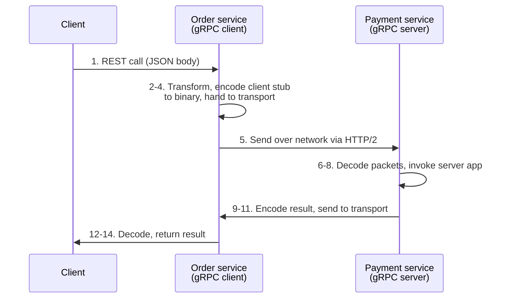

# API Design

An API is the part of a system you cannot refactor. Everything else is an implementation detail.

## 1. Choosing a protocol

| Protocol | Strengths | Weaknesses | Use for |
|---|---|---|---|
| **REST** | Simple, uniform, cacheable, universal tooling | Over/under-fetching; multiple round trips to assemble related data | Public APIs, CRUD resources, service-to-service where simplicity wins |
| **GraphQL** | One endpoint, exact payloads, nested queries, strong types, mutations + subscriptions | Complexity shifts to the client; caching is hard; abusive queries if unguarded | Many client shapes over the same data; rapidly changing frontend needs |
| **gRPC** | Binary Protobuf over HTTP/2, ~5× faster than JSON, bidirectional streaming, strong contracts, many languages | No native browser support (needs a proxy); harder to debug by hand | Internal service-to-service, low latency, streaming |
| **WebSocket** | Full-duplex persistent connection | Stateful; connection management at scale | Chat, collaborative editing, live dashboards |
| **SSE** | Server push over plain HTTP, auto-reconnect | Server → client only | Notifications, token streaming, progress |
| **Webhooks** | Push on event; no polling waste | Delivery is your problem: retries, signing, ordering | Third-party integrations, payment/shipping callbacks |
| **SOAP** | Formal contracts, WS-Security, mature enterprise tooling | Verbose, heavyweight | Legacy enterprise and financial integrations |

**REST vs GraphQL, decided honestly:** REST works well when you need simple, uniform interfaces
between separate services and straightforward caching. GraphQL wins when a single screen needs data
from many sources and clients evolve faster than the backend. GraphQL's costs are real: increased
complexity, over-fetching *by design* on the server side, and caching that no longer works via HTTP
semantics.

---

## 2. How gRPC actually works

RPC is "remote" because it enables communication between services deployed on different servers;
from the caller's point of view it looks like a local function call.



Binary encoding plus HTTP/2 network optimisations are what produce the ~5× speedup over JSON.

**Key features:** Protocol Buffers as the IDL (smaller and faster than JSON/XML), HTTP/2 transport,
wide language support, and bidirectional streaming for real-time applications.

---

## 3. REST design

**Resources and paths**

- Plural nouns for collections: `/orders`, `/orders/{id}/items`
- Verbs live in HTTP methods, never in the path (`POST /orders`, not `/createOrder`)
- **Semantic paths** — a reader should be able to guess the URL; a developer should be able to find
  the endpoint in the docs without searching
- **Domain-model driven** — derive the path structure from the domain model, not from the database
  schema or the UI

**HTTP methods and idempotency**

| Method | Purpose | Idempotent? | Notes |
|---|---|---|---|
| `GET` | Retrieve | ✅ | Never mutate. Safe and cacheable |
| `PUT` | Create or replace at a known URI | ✅ | Repeated identical requests → same state |
| `POST` | Create a new resource | ❌ | **Two identical POSTs create two resources** |
| `DELETE` | Remove | ✅ | Repeated deletes leave the same state |
| `PATCH` | Partial modification | ⚠️ | Depends on the patch semantics; the method teams most often get wrong |
| `HEAD` | Like GET without a body | ✅ | Existence and metadata checks |
| `OPTIONS` | Describe communication options | ✅ | CORS preflight |
| `CONNECT` | Establish a tunnel | — | Proxies |
| `TRACE` | Loop-back test along the path | ✅ | Usually disabled for security |

**POST's non-idempotency is why payments and order submission require idempotency keys.** Design it
in advance; retrofitting idempotency after a duplicate-charge incident is painful.

**Status codes** — deliberately use a small set. The categories: 1xx informational, 2xx success,
3xx redirection, 4xx client error, 5xx server error. A team that uses eight codes consistently beats
one that uses thirty inconsistently.

**Versioning** — decide before launch. `/v1/` in the path is the least surprising. Version when you
break a contract; add optional fields rather than versioning for additive change.

**Error envelope** — one consistent shape everywhere: a machine-readable code, a human-readable
message, and a request ID that appears in your logs.

**Batch operations** — use `batch` or `bulk` as a keyword at the **end** of the path
(`POST /orders/bulk`), so it reads as an operation on the collection.

**Query language** — define one set of rules for filtering, sorting, and pagination and apply it
across every collection endpoint. Inconsistency here is what makes an API feel amateur.

---

## 4. Pagination — six techniques

| Technique | Example | Pros | Cons |
|---|---|---|---|
| **Offset-based** | `GET /orders?offset=0&limit=3` | Trivial to implement and understand | Inefficient for large offsets — the DB scans and discards skipped rows |
| **Cursor-based** | `GET /orders?cursor=xxx` | Efficient at any depth; no scanning of skipped records | Slightly more complex; cursor must be opaque and stable |
| **Page-based** | `GET /items?page=2&size=3` | Easiest for UIs with page numbers | Same degradation as offset at high page numbers |
| **Keyset-based** | `GET /items?after_id=102&limit=3` | Efficient for large datasets; avoids offset scanning | Requires a unique indexed key; no random page access |
| **Time-based** | `GET /items?start_time=x&end_time=y` | Natural for time-ordered data; no records missed when new ones arrive | Needs a reliable consistent timestamp |
| **Hybrid** | `GET /items?cursor=abc&start_time=x&end_time=y` | Best performance and flexibility for complex datasets | Most complex; needs careful design |

**Rule:** offset and page-number pagination are acceptable for small, bounded collections. Anything
that grows — feeds, logs, events, orders — should use cursor or keyset from the start. Migrating
pagination style later is a breaking change.

---

## 5. Idempotency — the six places it is mandatory

1. **RESTful API requests** — retrying must not execute the operation twice. Use idempotent methods
   where possible; make POST idempotent with a key.
2. **Payment processing** — gateways retry. Without idempotency, customers are charged twice.
3. **Order management** — a resubmitted order must not duplicate inventory deductions.
4. **Database operations** — reapplying a transaction must not change state beyond the first application.
5. **User account management** — retried registration must not create two accounts; repeated password
   reset requests must produce one reset.
6. **Distributed systems and messaging** — reprocessing a message from a queue must not duplicate
   effects. **At-least-once delivery is the norm**, so duplicates are guaranteed, not hypothetical.

**Implementation:** the client generates a unique `Idempotency-Key` header per logical operation.
The server stores `(key → response)` with a TTL. A repeat key returns the stored response without
re-executing. Store the key in the *same transaction* as the effect, or the guarantee is fictional.

---

## 6. API performance — the top five

1. **Result pagination** — stream large result sets back rather than materialising them
2. **Asynchronous logging** — write to a lock-free buffer and return immediately; flush to disk
   periodically instead of touching the disk on every call
3. **Data caching** — check the cache before the database; Redis serves from memory
4. **Payload compression** — gzip requests and responses to cut transfer time
5. **Connection pooling** — reuse open database connections rather than opening and closing per request

---

## 7. API security

**Key generation** — issue one unique app ID per client, then separate public/private key pairs per
authorization scope (one pair for read-only, another for read-write). Scope separation limits the
blast radius of a leaked key.

**Signature generation** — verify authenticity and integrity of requests:

1. Collect the request parameters
2. Create a canonical string to sign
3. Hash it with HMAC-SHA256 using the secret key

**Request parameters that must be present:**

- Authentication credentials (app ID, access key)
- **Timestamp** — to prevent replay attacks
- Request-specific data (user IDs, transaction details)
- **Nonce** — a random per-request string, so each request is unique even if replayed within the
  timestamp window

**Every API, regardless of level:** authentication, per-resource authorization enforced in the
service layer (not just the gateway), input validation at the boundary, rate limiting, a consistent
error envelope, and request IDs propagated through headers.

---

## 8. Authentication methods

| Method | How | When to use |
|---|---|---|
| **Basic** | Username + password on every request | Simple internal cases, only over TLS. Weakest |
| **Token / JWT** | Signed token exchanged after login; no credentials on subsequent requests | Secure, scalable systems; the common default |
| **OAuth 2.0** | Access tokens issued after user authentication grant third parties limited access | Third-party access to user resources without sharing credentials |
| **API key** | A unique key per client in a header or parameter | Straightforward access control in less sensitive environments |

### Session vs JWT

**Session-based** — the server stores session data and hands the client a session ID cookie. Like an
airline ticket ID where all details live in the airline's database.

```
1. Login request → backend
2. Backend creates session, stores it in session storage
3. Server returns a cookie with the session ID
4. Subsequent requests send the session ID
5. Server looks up the session to authenticate
```

**JWT-based** — no server-side session store; the token itself carries the claims, signed.

```
1. Login request → backend
2. Server verifies credentials, issues a JWT signed with a private key
3. JWT returned to client (cookie or response body)
4. Subsequent requests send the JWT
5. Server verifies the signature and extracts user info — no lookup
```

**The trade:** sessions give you instant revocation at the cost of a lookup and a store. JWTs give
you statelessness at the cost of revocation-before-expiry needing extra machinery (deny lists, short
expiry plus refresh tokens). Choose on whether instant revocation matters.

**JWT structure** — header (type and algorithm), payload (claims), signature (created with a secret
so tampering is detectable). All three are just base64url JSON — **the payload is readable by
anyone**. Never put secrets in it.

### OAuth 2.0 flows

- **Authorization Code Flow** — the most common. After authentication the client receives an
  authorization code and exchanges it for an access token and refresh token. Use this for web apps.
- **Client Credentials Flow** — machine-to-machine, no user involved.
- **Implicit Flow** — the access token is returned directly with no intermediate code. Designed for
  single-page apps; now discouraged in favour of Authorization Code with PKCE.
- **Resource Owner Password Grant** — the user gives credentials directly to the client, which
  exchanges them for a token. Avoid unless you own both sides and have no alternative.

An OAuth token enables SSO, authorization across systems, and scoped access to a user profile —
without the third party ever seeing a password.

### SSO — how it works

```mermaid
sequenceDiagram
    participant U as User
    participant G as Gmail
    participant S as SSO auth server
    participant Y as YouTube
    U->>G: 1. Visit
    G->>S: Not logged in → redirect
    U->>S: Enter credentials
    S->>S: 2-3. Validate, create global session, create token
    S->>G: 4-7. Gmail validates token; server registers Gmail, returns "valid"
    G->>U: Protected resource
    U->>Y: 8. Navigate to YouTube
    Y->>S: 9-10. Not logged in → request auth; server sees existing session, returns token
    Y->>S: 11-14. Validate token; server registers YouTube, returns "valid"
    Y->>U: Protected resource
```

The essential mechanism: a **global session** on the authentication server, and per-application
registration against it.

---

## 9. Polling vs webhooks

**Polling** — repeatedly ask an external service for updates at a fixed interval. Resource-intensive
and inefficient: most calls return nothing. You only get updates when you ask, so real-time
information is missed. But you control when and how data is fetched.

**Webhooks** — you expose an endpoint and register it as a callback. The external service calls you
when something happens. Efficient and near-real-time.

**Choose polling** when infrastructure prevents inbound calls (firewalls, no public endpoint).
**Choose webhooks** for instant delivery and efficiency in high-throughput environments — but you
must build retry handling, because network issues cause missed notifications.

**Webhook implementation checklist:** sign payloads (HMAC) so receivers can verify origin; retry
with exponential backoff; make handlers idempotent (retries mean duplicates); return 2xx fast and
process asynchronously; expose a replay mechanism for missed events.

---

## 10. API testing — nine types

| Type | What it verifies |
|---|---|
| **Smoke** | After development completes: the APIs work and nothing is obviously broken |
| **Functional** | Results match the functional requirements |
| **Integration** | Several API calls combined; intra-service communication and data transmission |
| **Regression** | Bug fixes and new features have not broken existing behaviour |
| **Load** | Performance under simulated load; establishes capacity |
| **Stress** | Deliberately high load; does the API still function |
| **Security** | Behaviour against external threats |
| **UI** | The UI interacts with the APIs and displays data correctly |
| **Fuzz** | Invalid or unexpected input injected to crash the API and reveal vulnerabilities |

---

## 11. GraphQL adoption patterns

Teams usually start with one client querying one GraphQL server, then evolve:

1. **Client-based GraphQL** — the client wraps existing APIs behind a single GraphQL endpoint.
   Better developer experience, but the client still pays the aggregation cost.
2. **GraphQL with BFFs** — each client gets a dedicated Backend-for-Frontend service. GraphQL is a
   natural fit for a client-focused intermediary. Improves client performance and DX, at the cost of
   building and maintaining a BFF per client.
3. **Monolithic GraphQL** — multiple teams share one GraphQL server codebase, or one team owns an
   API used by many client teams. The shared codebase becomes the bottleneck.
4. **GraphQL Federation** — multiple graphs consolidated into a supergraph. A federated gateway
   routes to downstream subgraph services, each owning part of the schema. **Data ownership stays
   with the domain team while duplication is avoided.** This is the organisational solution, and why
   Netflix and Reddit both landed here.

---

## 12. HTTP/2 — why it is faster than HTTP/1

1. **Binary framing layer** — messages are encoded into binary and split into frames, processed more
   efficiently than text
2. **Multiplexing** — full request and response multiplexing over one TCP connection; frames are
   interleaved and reassembled, eliminating head-of-line blocking at the HTTP layer
3. **Stream prioritisation** — relative weights let the server send more frames for higher-priority
   requests
4. **Server push** — additional resources can be sent alongside the requested page
5. **HPACK header compression** — header compression across requests saves significant bandwidth

HTTP/2 is not universally faster — it depends on the scenario, so measure rather than assume.

---

## 13. Eight tips for efficient API design

1. **Domain-model driven** — derive the path structure from the domain model
2. **Choose proper HTTP methods** — a small, well-understood set; PATCH is where teams go wrong
3. **Implement idempotence properly** — design it in advance; GET is idempotent, POST needs work
4. **Choose proper status codes** — a limited set, used consistently
5. **Versioning** — design the version scheme up front to simplify upgrades
6. **Semantic paths** — users should find the right API in the docs without searching
7. **Batch processing** — `batch`/`bulk` keyword at the end of the path
8. **Query language** — consistent pagination, sorting, and filtering rules across all endpoints
