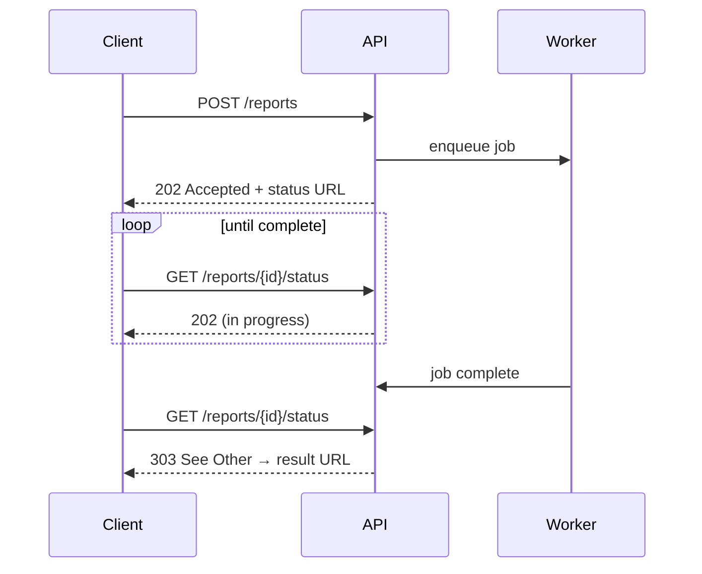
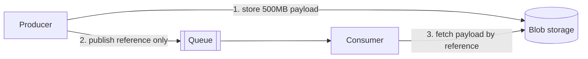
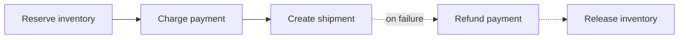
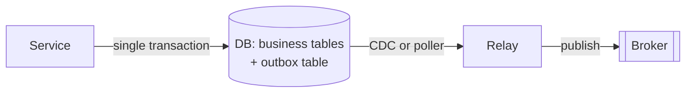

# Messaging and Event-Driven Systems

Asynchrony is how you decouple components, absorb spikes, and keep the request path fast. It is also
how you acquire eventual consistency, duplicate deliveries, and debugging that spans five services.
Both arrive together.

## 1. The three messaging shapes

| Shape | Semantics | Use for | Examples |
|---|---|---|---|
| **Queue** (point-to-point) | Each message consumed by exactly one consumer | Work distribution, job processing | Azure Service Bus queue, SQS, RabbitMQ, BullMQ |
| **Pub/sub** (fan-out) | Each message delivered to every subscriber | One event, many independent reactions | Service Bus topics, Event Grid, SNS, Redis pub/sub (ephemeral only) |
| **Log** (replayable stream) | Ordered, retained, consumers track their own offset | Event sourcing, analytics, high-throughput ingestion, replay | Kafka, Event Hubs, Kinesis |

The distinction that matters: a **queue** deletes a message once handled; a **log** retains it, so a
new consumer can read history from the beginning. If you might need to add a consumer later that
cares about past events, you need a log.

---

## 2. The six cloud messaging patterns

### 2.1 Asynchronous Request-Reply

Provides determinism for long-running backend tasks and decouples backend processing from frontend
clients.



The client makes a synchronous call that triggers long-running work. The API returns **HTTP 202
Accepted**, acknowledging receipt for processing. The client polls a status endpoint or receives a
callback.

### 2.2 Publisher-Subscriber

Decouples senders from consumers and avoids blocking the sender while waiting for a response.
Publishers know nothing about subscribers. Adding a new reaction is a deploy of the new subscriber
only.

### 2.3 Claim Check

Solves transmission of large messages. Store the whole payload in a database or blob store, and
transmit **only the reference**. The consumer retrieves the payload when it needs it.



Use whenever payloads approach broker message-size limits — which are lower than people expect
(256 KB on SQS, 256 KB–1 MB typical on Service Bus tiers).

### 2.4 Priority Queue

Prioritises requests so higher-priority messages are received and processed faster than lower ones.
Implemented either with separate queues per priority and weighted consumers, or with a broker that
supports priority natively.

### 2.5 Saga

Manages data consistency across multiple services in distributed systems where each service owns its
own database. Addresses maintaining consistency **without distributed transactions**, which are hard
to scale and hurt performance.

A saga is a sequence of local transactions. If one fails, previously completed steps are undone by
**compensating transactions** — not rolled back, but semantically reversed.



**Two coordination styles:**
- **Orchestrated saga** — a coordinator drives each step and issues compensations. Readable,
  debuggable, centralised.
- **Choreographed saga** — each service reacts to the previous service's event and emits its own.
  Loosely coupled; the process exists nowhere in readable form.

**Design requirement:** every step needs a compensating action defined *before* you build it. "What
undoes this?" is the first question, and for some operations (an email sent, a physical shipment)
there is no true compensation — which is a design constraint, not an oversight.

### 2.6 Competing Consumers

Multiple concurrent consumers process messages from the same channel, with no complex coordination
between them. Scales throughput by adding consumers.

**Critical caveat: this pattern cannot guarantee message ordering.** If order matters, you need
partitioning by key (Kafka) or session/group-based ordering (Service Bus sessions), which trades
parallelism for ordering.

---

## 3. Nine architectural patterns for data and communication flow

- **Peer-to-Peer** — direct communication between two components, no central coordinator
- **API Gateway** — a single entry point for all client requests to backend services
- **Pub-Sub** — producers decoupled from consumers through a broker
- **Request-Response** — the most fundamental pattern; client sends, waits for a response
- **Event Sourcing** — application state changes stored as a sequence of events
- **ETL** — gather from multiple sources, transform to a structured format, load into a destination
- **Batching** — accumulate data over a period or until a threshold, then process as one group
- **Streaming Processing** — continuous ingestion, processing, and analysis of data streams in real time
- **Orchestration** — a central coordinator manages interactions to achieve a workflow

---

## 4. Kafka

### Fundamentals

1. **What it is** — a distributed event store and streaming platform. Started at LinkedIn; now powers
   some of the largest data pipelines in the world (Netflix, Uber).
2. **Messages** — the basic unit of data: headers, key, and value. Like a record in a table.
3. **Topics and partitions** — every message goes to a topic (think: a folder). Topics have multiple
   partitions, which are the unit of parallelism and ordering. **Ordering is guaranteed within a
   partition, never across partitions.**
4. **Advantages** — handles multiple producers and consumers, disk-based retention, high scalability.
5. **Producers** — create messages, batch them, send to a topic, and balance messages across partitions.
6. **Consumers** — work together as a **consumer group** to read from brokers. Each partition is
   consumed by exactly one member of the group, which is why consumer count above partition count
   adds nothing.
7. **Cluster** — several brokers; each partition is replicated across brokers for availability.
8. **Use cases** — log analysis, data streaming, change data capture, system monitoring.

### Why Kafka is fast

Two design decisions carry most of the weight:

**1. Sequential I/O** — Kafka appends to a log file rather than seeking randomly. Sequential disk
access is orders of magnitude faster than random access, and on spinning disks the difference is
enormous. The log structure is the performance feature.

**2. Zero copy** — avoiding redundant copies between kernel and application space:

```
WITHOUT zero-copy (4 copies):
  disk → OS cache → Kafka application → socket buffer → network card → consumer

WITH zero-copy (2 copies):
  disk → OS cache → (sendfile syscall) → network card → consumer
```

The `sendfile()` syscall lets the OS cache write straight to the network card, skipping the trip
through application memory and the socket buffer entirely.

### Top five Kafka use cases

Log processing and analysis · data streaming in recommendations · system monitoring and alerting ·
change data capture · system migration (dual-write, verify, cut over).

### Can Kafka lose messages?

Yes. "Kafka guarantees no message loss" is a belief, not a property. Loss can occur at all three
stages.

**Producer** — `producer.send()` does not go straight to the broker. Three things are involved: the
application thread, the **record accumulator** (an in-memory batching buffer), and the **sender
thread** (I/O). A crash between accumulation and send loses whatever is buffered.
→ Configure `acks` and `retries` properly. `acks=all` waits for all in-sync replicas.

**Broker** — a healthy cluster should not lose messages, but two extremes cause it:
1. Messages are **flushed to disk asynchronously** for I/O throughput. If the instance dies before
   the flush, those messages are gone.
2. Replicas must be configured to hold a valid copy. Determinism in data synchronisation matters —
   `min.insync.replicas` and disabling unclean leader election.

**Consumer** — Kafka offers several commit modes. **Auto-commit can acknowledge records before they
are actually processed.** If the consumer dies mid-processing, those records are never processed and
never redelivered.
→ Good practice: combine both commit styles — asynchronous commits inside the processing loop for
throughput, and a **synchronous commit in the exception/shutdown handler** so the last offset is
always committed.

---

## 5. Non-negotiables for any messaging system

- **Consumers must be idempotent.** At-least-once delivery is the norm, so duplicates are guaranteed.
- **Dead-letter queues with alerting.** A DLQ nobody watches is a silent data-loss mechanism.
- **Poison-message handling.** A message that always fails must be moved aside after N attempts, not
  retried forever at the head of the queue.
- **Bounded queues and backpressure.** Unbounded buffering converts a latency problem into an outage.
- **Consumer lag monitoring.** Lag is the single best leading indicator that something downstream is
  failing.
- **The outbox pattern** when a database write and an event publish must both succeed.

### The outbox pattern

The problem: you cannot atomically write to your database and publish to a broker. If you write then
publish and the publish fails, you have a state change nobody heard about. If you publish then write
and the write fails, you have announced something that did not happen.



Write the business change and an outbox row **in one local transaction**. A separate relay (a poller,
or CDC reading the transaction log) publishes outbox rows and marks them sent. The atomic unit is a
single database transaction, which databases already guarantee.

---

## 6. Event sourcing in practice

Three shapes from real systems:

1. **New York Times** — every article, image, and byline since 1851 is stored in an event store. Raw
   data is denormalised into different views and fed into Elasticsearch nodes for site search.
2. **Change Data Capture** — a connector pulls from database tables (via the transaction log) and
   transforms changes into events, pushed to Kafka where other sinks consume them.
3. **Microservice connector** — the shopping cart service generates events for adding and removing
   items. Kafka acts as the event store. Fraud, billing, and email services each consume those
   events and **determine their own domain model independently** — which is the real payoff.

---

## 7. Retry strategies

Four strategies, in increasing order of correctness under load:

**Linear backoff** — wait a progressively increasing fixed interval.
*Pro:* simple. *Con:* under high concurrency, retries stay synchronised and cause resource contention
or retry storms.

**Linear jitter backoff** — linear increase plus a random offset.
*Pro:* randomness spreads attempts, reducing synchronised retries. *Con:* the base interval grows
only linearly, so at scale collisions still occur.

**Exponential backoff** — 1s, 2s, 4s, 8s… up to a maximum.
*Pro:* significantly reduces system load and collision likelihood; suitable for high-load
environments. *Con:* when a quick retry would have resolved the issue, it delays recovery
unnecessarily.

**Exponential jitter backoff** — exponential increase plus randomness (additive or multiplicative).
*Pro:* all the benefits of exponential, with collisions reduced further. **This is the correct
default.** *Con:* randomness can occasionally produce longer-than-necessary delays.

**Rules that matter more than the curve:**
- **Only retry idempotent operations.** Retrying a non-idempotent POST is how duplicate charges happen.
- **Cap total attempts and total elapsed time**, not just the interval.
- **Never retry a 4xx.** The request is wrong; repeating it will not fix it.
- **Combine with a circuit breaker.** Retries against a dead dependency are a self-inflicted DDoS.

---

## 8. Data pipelines

Five phases, and every data platform is some arrangement of them:

1. **Collect** — data acquired from data stores, data streams, and applications; sourced remotely
   from devices, applications, or business systems
2. **Ingest** — loaded into systems and organised within event queues
3. **Store** — organised data placed into warehouses, lakes, lakehouses, and databases
4. **Compute** — aggregation, cleansing, and manipulation to conform to standards: format conversion,
   compression, partitioning. Uses both **batch and stream** processing
5. **Consume** — made available through analytics and visualisation tools, operational data stores,
   decision engines, user-facing applications, dashboards, data science, ML services, BI, and
   self-service analytics

**Batch vs stream** — batch collects data and processes it all at once (daily billing). Stream
processes in real time (fraud detection). The Lambda architecture runs both and merges; the Kappa
architecture runs stream only and replays the log for reprocessing.

---

## 9. Messaging by level

**L1** — no broker. Use in-process background tasks, or a `jobs` table in Postgres polled with
`SELECT ... FOR UPDATE SKIP LOCKED`. This is durable, transactional with your data, and requires zero
new infrastructure. It covers far more ground than people expect.

**L2** — a managed queue (Service Bus, SQS) plus workers, once you need fan-out, priorities, or
independently scaled workers. Dead-letter queues and idempotent consumers from day one. Pub/sub for
genuinely independent reactions.

**L3** — an event-streaming backbone (Kafka/Event Hubs) as shared infrastructure: CDC pipelines,
analytics streams, cross-team event contracts, replay for new consumers. At this point the broker is
a platform other platforms depend on, with schema registry, topic naming conventions, and ownership
rules.
