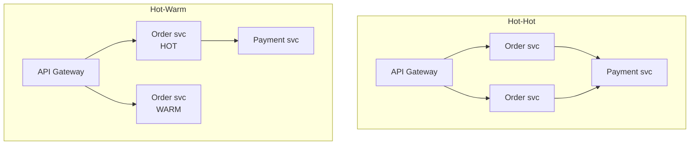

# Reliability and Failure

Designing for failure is not pessimism; in a distributed system, failure is the steady state.
A distributed system with microservices **is going to fail** — the design question is only whether
it fails safely.

## 1. The Fantastic Four of system design

Four properties, and the concrete techniques that produce each:

| Property | Means | Techniques |
|---|---|---|
| **Scalability** | Handles more load without degrading performance | Vertical scaling · horizontal scaling · microservices |
| **Availability** | Always ready to serve; minimal downtime | Load balancing · replication (primary → replicas) · failover (active/passive) |
| **Reliability** | Consistently delivers correct results | Monitoring & logging (ELK) · error handling with retries · automated tests |
| **Performance** | Carries out tasks at the expected rate under peak load | Database indexing · caching · async processing |

Note that **reliability ≠ availability**: a system that is always up and returns wrong answers is
available and unreliable. They are attacked with different tools.

---

## 2. High availability

**Measurement**

| Target | Downtime/day | Downtime/month | Downtime/year |
|---|---|---|---|
| 99% | 14.4 min | 7.2 h | 3.65 days |
| 99.9% ("3 nines") | 86 s | 43 min | 8.76 h |
| 99.99% ("4 nines") | **8.64 s** | 4.3 min | 52.6 min |
| 99.999% ("5 nines") | **864 ms** | 26 s | 5.26 min |

Two consequences follow immediately:

1. **Above 3 nines, no human is in the recovery path.** 8.64 seconds a day does not permit paging
   anyone. Failover must be automatic and rehearsed.
2. **Dependencies multiply.** Five sequential dependencies at 99.9% each yield 99.5% overall. Every
   service added to the critical path lowers availability unless it is made optional.

**Two principles:** redundancy, and no single point of failure.

**Four redundancy topologies**



- **Hot-hot** — both instances receive the same input and both send output downstream. If one dies,
  the other continues with zero switchover. **The downstream system must deduplicate**, which is the
  hidden cost people forget.
- **Hot-warm** — both receive input, only the hot side emits. If the hot side dies, the warm side
  starts emitting. No dedupe needed; a brief switchover gap.
- **Single-leader cluster** — one leader receives from upstream and replicates to replicas. Simple;
  the leader is a failover point.
- **Leaderless cluster** — no leader; any write replicates to other instances. As long as
  **W + R > N** (write quorum plus read quorum exceeds total nodes), reads return valid data.

---

## 3. Six principles of fault-tolerant systems

1. **Replication** — multiple copies of data or services across nodes or locations
2. **Redundancy** — additional components that take over on failure
3. **Load balancing** — distributes traffic so no single server is a point of failure
4. **Failover mechanisms** — automatically switch to a standby when the primary fails
5. **Graceful degradation** — continue at reduced functionality rather than failing completely
6. **Monitoring and alerting** — continuously watch health and alert on anomalies

**Graceful degradation deserves the most design attention** because it is the one that requires
product decisions. Decide in advance, per dependency:

| Dependency down | Degraded behaviour |
|---|---|
| Cache | Serve from database at reduced throughput; shed non-core traffic |
| Search | Hide search UI, offer browse; do not 500 the page |
| Recommendations | Show a static popular list |
| Payment provider | Queue the order, notify the user, retry |
| Analytics / logging sink | Drop on the floor; never block the request path |

"Returns 500" is a decision, but it is usually the wrong one.

---

## 4. In-process resilience patterns

- **Timeouts on every outbound call.** No exceptions. A call without a timeout is an unbounded
  liability. Edge timeouts should be *shorter* than origin timeouts, so the caller gives up first.
- **Retries with exponential backoff and jitter**, only on idempotent operations. See
  `09-messaging-and-events.md` §7.
- **Circuit breakers** around flaky dependencies. Three states: closed (normal), open (fail fast
  without calling), half-open (probe with a trickle to test recovery). This is what stops retries
  from becoming a self-inflicted denial of service.
- **Bulkheads** — isolate resource pools per dependency so one saturated pool cannot starve the
  others. A slow third-party API should consume its own connection pool, not all of them.
- **Load shedding** — when saturated, reject cheaply and early at the edge. A fast 503 to 10% of
  traffic beats a slow collapse for 100%.
- **Backpressure** — bounded queues, rate limits, admission control. Unbounded buffering converts a
  latency problem into an outage.
- **Hedged requests** (L3) — for p99 tail latency, issue a duplicate request after a short delay and
  take whichever returns first. A few percent extra traffic for a sharply reduced tail.

---

## 5. Detecting node failures — six heartbeat mechanisms

| Mechanism | How | Trade-off |
|---|---|---|
| **Push-based** | Node periodically sends a signal; silence beyond an interval means failure | Simple; network congestion causes **false positives** |
| **Pull-based** | A central monitor periodically pulls status from nodes | Less network traffic; slower detection |
| **With health check** | Heartbeat carries diagnostics (CPU, memory, app metrics) | Richer decisions; more complexity and overhead |
| **With timestamps** | Heartbeat includes a timestamp | Distinguishes "dead" from "network delayed" |
| **With acknowledgement** | Receiver must acknowledge | Confirms the network path works both ways, not just the sender |
| **With quorum** | A majority of nodes must agree (Paxos, Raft) | Correct under partition; complex, and membership changes are hard |

**The false-positive problem is the real one.** A node marked dead that is actually alive causes
split-brain, duplicate processing, and data divergence. Tune detection windows for your actual
network jitter, and prefer quorum where correctness matters.

---

## 6. The four cache failure modes

Because caching is the most common cause of L2 incidents, it has its own document — see
`07-caching.md` §4. In summary:

1. **Thundering herd** — many keys expire together → jitter TTLs, protect core data only
2. **Cache penetration** — key absent from cache *and* database → cache nulls, bloom filter
3. **Cache breakdown** — a single hot key expires (hot keys ≈ 80% of queries) → never expire hot
   keys, single-flight, serve stale while revalidating
4. **Cache crash** — cache down, all traffic hits the database → circuit breaker, cache cluster

---

## 7. Disaster recovery

Two benchmarks define every DR plan:

- **RTO (Recovery Time Objective)** — maximum acceptable time offline after a disaster
- **RPO (Recovery Point Objective)** — maximum acceptable data loss, measured in time

| Strategy | Description | Typical RTO | Typical RPO | Cost |
|---|---|---|---|---|
| **Backup & restore** | Regular backups of data and systems | Hours to days | Hours, to last successful backup | Lowest |
| **Pilot light** | Crucial components ready to activate, scaled to near zero | Minutes to hours | Depends on sync frequency | Low |
| **Warm standby** | Semi-active environment with current data | Minutes to hours | Last few minutes or hours | Medium |
| **Hot site / multi-site** | Fully operational duplicate running in parallel | Almost immediate | Seconds | Highest |

**Choose from stated RTO/RPO requirements, not ambition.** Do not buy more DR than the business
needs — and get the business to state the number, because "no downtime" is not a requirement, it is
a wish.

**By level:** L1 → backup & restore (managed backups, verify one restore). L2 → warm standby.
L3 → hot site / active-active, at which point conflict resolution becomes a first-class design
problem requiring a per-data-type merge strategy.

**Test restores.** An untested backup is a hope, not a plan. This is the single most commonly
skipped step and the one that turns an incident into a company-ending event.

---

## 8. Eight common problems and their solutions

| Problem | Solution |
|---|---|
| **Read-heavy system** | Caching to make reads faster |
| **High-write traffic** | Async workers to process writes; LSM-tree-backed databases |
| **Single point of failure** | Redundancy and failover for critical components like databases |
| **High availability requirement** | Load balancing to healthy instances; database replication |
| **High latency** | CDN to move content closer to users |
| **Handling large files** | Block storage and object storage |
| **Monitoring and alerting** | Centralised logging (ELK stack) |
| **Slower database queries** | Proper indexes; sharding to scale horizontally |

---

## 9. Where L2 systems actually die

Ranked by how often they cause the incident:

1. **The cache** — stampede on expiry, a hot key, or a cold start after deploy taking out the database
2. **Connection exhaustion** — no pooler, or a pool sized for the wrong concurrency model. Presents
   as "the database is slow"
3. **A retry storm** — no jitter, no circuit breaker; a slow dependency becomes a full outage
4. **An unbounded query** — pagination missing on an endpoint that used to return 20 rows
5. **The queue** — no dead-letter queue, a poison message, silent backlog growth
6. **Replica lag** — a read-your-own-writes bug that only appears under load

Each has a mitigation above. Designing for these six is most of what separates an L2 system that
stays up from one that does not.

---

## 10. Diagnosing production problems

**Linux performance observability tools**

| Tool | Reports |
|---|---|
| `vmstat` | Processes, memory, paging, block IO, traps, CPU activity |
| `iostat` | CPU and input/output statistics |
| `netstat` | Statistics for IP, TCP, UDP, ICMP |
| `lsof` | Open files on the current system |
| `pidstat` | Per-process resource use: CPU, memory, device IO, task switching, threads |
| `top` / `ps` | Process listing and resource use |

**Nine causes of 100% CPU**

1. Infinite loops
2. Background processes
3. High traffic volume
4. Resource-intensive applications
5. **Insufficient memory** (GC thrash or swapping presents as CPU)
6. Concurrent processes
7. **Busy waiting** (spin loops instead of blocking)
8. **Regular expression matching** (catastrophic backtracking — a real DoS vector)
9. Malware

Items 5, 7, and 8 are the ones that surprise people, because the symptom (CPU) is far from the cause.

**Log parsing toolkit** — `grep` (select matching lines), `cut` (extract fields), `sed` (stream
edit), `awk` (pattern scanning and processing), `sort`, `uniq`. Composed together they answer most
questions faster than a log platform:

```bash
grep "xxService" service.log | grep "Exception" | cut -d" " -f 2
```

---

## 11. Observability

Three pillars, ordered by how much they help you at 3am:

**1. Structured logs** — JSON, a request ID on every line, no secrets or PII. Log decisions and
errors, not noise. The request ID propagated across service boundaries is what makes a distributed
system debuggable at all.

**2. Metrics** — two complementary frameworks:
- **RED** for services: **R**ate, **E**rrors, **D**uration
- **USE** for resources: **U**tilization, **S**aturation, **E**rrors

**Alert on symptoms, not causes.** Page on error rate and p99 latency; do not page on CPU. A machine
at 90% CPU with healthy latency is a machine doing its job. This single rule eliminates most alert
fatigue.

**3. Traces** — distributed tracing (OpenTelemetry) once more than two services participate in a
request. Below that threshold, logs with a request ID are sufficient and much cheaper.

**Every alert needs an owner and a runbook**, or it will be muted within a month.

**For LLM systems, add:** token usage per request, cost per conversation, tool-call success rate,
retrieval hit quality, and eval scores tracked over time.

---

## 12. Website and frontend performance

**Nine metrics that matter**

| Metric | What it tells you |
|---|---|
| **Load time** | Total time to download and display the page |
| **TTFB** (Time to First Byte) | Server's general ability to handle traffic |
| **Request count** | Number of HTTP requests to fully load; lower feels faster |
| **DOMContentLoaded** | Time for the full HTML to load (excludes CSS and assets) |
| **Time to above-the-fold load** | When the content the user first sees is ready |
| **First Contentful Paint** | When content first begins painting — text, image, or background |
| **Page size** | Total size of all content and assets; steadily growing industry-wide |
| **Round Trip Time** | Browser → origin → browser; reducing it is a key lever |
| **Render-blocking resources** | Resources that delay the rest of the page |

**Eight techniques to load faster**

1. **Compression** — minimise data size before transmission
2. **Selective rendering / windowing** — render only visible elements in long lists
3. **Modular architecture with code splitting** — many smaller bundles instead of one large one
4. **Priority-based loading** — essential and above-the-fold content first
5. **Pre-loading** — fetch resources before they are requested
6. **Tree shaking / dead code removal** — strip code that will never run
7. **Pre-fetching** — proactively cache what is likely needed soon
8. **Dynamic imports** — load modules on user action to cut initial load

**Six strategies to reduce latency overall:** database indexing, caching, load balancing, CDN, async
processing, data compression.

Anchor: Amazon found every 100 ms of latency cost 1% in sales — roughly $5.7B in today's terms.
Latency is revenue, and this is the number to quote when performance work needs justification.

---

## 13. Testing

**Six ways to test system functionality**

1. **Unit testing** — individual components work correctly in isolation
2. **Integration testing** — different parts function together
3. **System testing** — the whole system against user requirements and performance
4. **Load testing** — ability to handle high workloads; identifies performance issues
5. **Error testing** — behaviour with invalid inputs and error conditions
6. **Test automation** — automated execution for efficiency, repeatability, and error reduction

See `08-api-design.md` §10 for the nine API-specific test types.

---

## 14. Reliability engineering at L3

- **Chaos engineering** — Netflix's Chaos Monkey terminates instances in production continuously,
  because untested failover does not work. The point is to discover the failure on a Tuesday
  afternoon rather than during a launch.
- **Error budgets** — 99.99% is a budget of 8.64 seconds a day. Spend it deliberately on releases;
  when it is exhausted, feature work stops until reliability is restored. This is what turns an
  availability target into a real constraint instead of a slogan.
- **Cell-based architecture and shuffle sharding** — contain a failure to one cell rather than the
  whole system. See `03-level-3-hyperscale.md`.
- **Game days** — rehearse the regional failover with the people who would actually run it.
