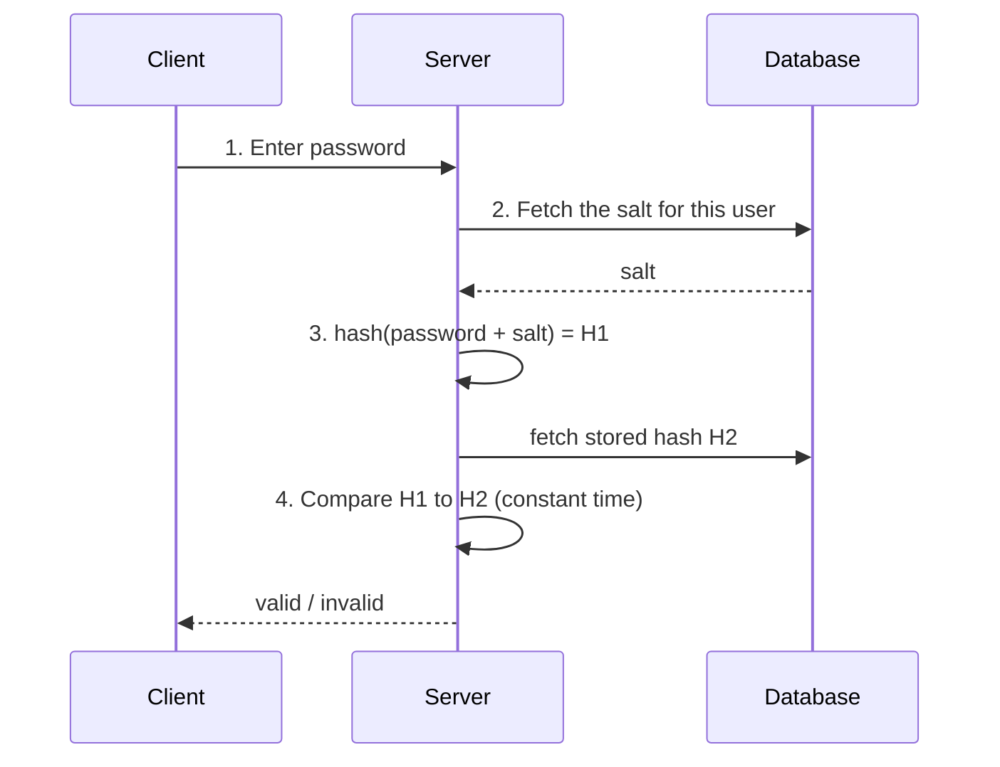

# Security

Security is a design property, not a phase. Retrofitting it costs more than building it in, and
some of it (key management, data segregation, audit trails) cannot be retrofitted at all.

## 1. The secure-system design checklist

Twelve domains to walk when designing or reviewing a system:

1. **Authentication** — who is this
2. **Authorization** — what may they do
3. **Encryption** — in transit and at rest
4. **Vulnerability management** — dependencies, images, code
5. **Audit and compliance** — who did what, provably
6. **Network security** — segmentation, firewalls, private endpoints
7. **Terminal / endpoint security** — the devices with access
8. **Emergency response** — the plan for when it happens
9. **Container security** — images, runtime, registry
10. **API security** — the largest attack surface in a modern system
11. **Third-party vendor management** — your supply chain is your risk
12. **Disaster recovery** — availability is a security property

---

## 2. Sensitive data

**What counts as sensitive:** personally identifiable information (PII), health information,
intellectual property, financial information, education and legal records.

Most jurisdictions regulate this. GDPR in the EU sets stringent rules; non-compliance brings fines,
legal action, and sanctions. Design for data protection from the start.

### Encryption and key management

- Transmission encrypted with TLS
- Passwords never stored in plain text
- **Key storage with separation of duties** — split responsibility across distinct roles: a password
  applicant, a password manager, and an auditor, each holding one piece. All three pieces are
  required to open the lock. No single person can unilaterally access the key material.
- Algorithms like **GCM** store cipher data and keys separately, so obtaining one does not decipher
  the data

### Data desensitization

Also called anonymization or sanitization: removing or modifying personal information so individuals
cannot be readily identified. Crucial when sharing data externally (research, statistics) *and*
internally, to limit access to sensitive information.

Techniques: masking, tokenization, generalisation, pseudonymisation, differential privacy for
aggregates. Note that naive anonymisation is often reversible through correlation — treat
"anonymised" data as sensitive unless you have tested re-identification risk.

### Minimal permissions

Grant the least privilege necessary. **RBAC (Role-Based Access Control)** restricts access based on
organisational roles and is the standard mechanism, simplifying permission management and ensuring
users reach only the information necessary for their role.

### Data lifecycle management

When building data products (reports, feeds), grant developers the permissions they need during
development — and **revoke them once the product is live**. Standing production data access for
developers is the most common finding in real audits.

---

## 3. Encoding vs encryption vs tokenization

Three distinct processes, frequently confused, with different security properties.

| | **Encoding** | **Encryption** | **Tokenization** |
|---|---|---|---|
| **Purpose** | Format conversion for transmission | Confidentiality | Remove sensitive data from scope |
| **Mechanism** | A public, reversible scheme (Base64) | Algorithms with keys | Substitution with a meaningless token; mapping held in a vault |
| **Reversible by** | Anyone, with the same scheme | Only key holders | Only the token vault |
| **Is it security?** | **No** | Yes | Yes |
| **Typical use** | Binary data over text channels | Data at rest and in transit | Card numbers, PINs, PCI DSS scope reduction |

**Encoding is not security.** Base64 is not obfuscation of any value. This confusion appears in real
code reviews often enough to be worth stating plainly.

**Encryption** can be symmetric (same key both ways) or asymmetric (public key encrypts, private key
decrypts).

**Tokenization** is particularly powerful for compliance: tokens contain no part of the original
data and cannot be reverse-engineered, so systems handling only tokens fall outside PCI DSS scope.

---

## 4. Password storage and validation

**What not to do**

- **Plain text** — anyone with internal access reads them
- **A bare hash** — vulnerable to precomputation attacks such as rainbow tables

**What to do — salting**

Per OWASP, a salt is "a unique, randomly generated string that is added to each password as part of
the hashing process".

- A salt is **not secret** and may be stored in plain text in the database. Its job is to make each
  hash unique, defeating precomputation
- Store as `hash(password + salt)`
- Use a slow, memory-hard function: **bcrypt, scrypt, or Argon2** — not SHA-256, which is fast and
  therefore easy to brute-force

**Validation flow**

Compare in constant time to avoid timing attacks. Better still: do not own authentication. Use a
managed identity provider (Entra ID, Auth0, Okta) and inherit their controls.

---

## 5. Cross-Site Scripting (XSS)

Malicious scripts injected into web pages, usually through input fields, executed in other users'
browsers.

**Two forms**

- **Reflective XSS** — the injected script executes immediately, reflected off a request (typically
  a crafted link). Transient but effective in phishing.
- **Stored XSS** — the script is persisted (a comment, a profile field) and served to every
  subsequent visitor. Long-lived and far more damaging.

**The attack:** harvest credentials or cookies from the victim's browser, leading to session
hijacking, account takeover, and data breach.

**Mitigations**

- **Input validation** at the boundary
- **Output encoding** — encode contextually for HTML, attribute, JavaScript, and URL contexts. This
  is the primary defence; validation alone is insufficient
- **Content Security Policy (CSP)** — restrict which scripts may execute
- **HttpOnly cookies** — make session cookies unreadable from JavaScript, which defeats the most
  common payload
- **SameSite cookies** — mitigate the CSRF class alongside it

---

## 6. Cookies and session security

A cookie is state handed to the client so the stateless HTTP protocol can remember an identity.

**Attributes that matter for security:**

- **HttpOnly** — inaccessible to JavaScript; the main XSS mitigation for session cookies
- **Secure** — sent only over HTTPS
- **SameSite** — controls cross-site sending: `Strict`, `Lax`, or `None` (which requires `Secure`).
  The primary CSRF defence
- **Domain** and **Path** — scope; browsers enforce that cookies are not sent to the wrong site
- **Name** / **Value** — the payload itself; never put anything sensitive here in readable form

---

## 7. HTTPS, TLS, and the handshake

HTTPS protects data from eavesdropping and tampering through encryption and digital certificates.

The **SSL/TLS handshake** establishes a secure connection: the parties negotiate cipher suites,
authenticate the server via its certificate (and optionally the client), and exchange keys to derive
a shared session key. Subsequent traffic uses fast symmetric encryption through that tunnel.

The important properties in design terms: **confidentiality** (eavesdroppers see nothing),
**integrity** (tampering is detectable), and **authenticity** (the certificate chain proves you are
talking to who you think). Terminate TLS at the load balancer or gateway to offload the cost from
backends — but if the internal network is untrusted, re-encrypt on the internal hop too.

---

## 8. Network security

**Six firewall use cases**

1. **Port-based rules** — allow or block by port (e.g. only 80 and 443 for web)
2. **IP address filtering** — allow or deny by source/destination; allowlist trusted, blocklist known-malicious
3. **Protocol-based rules** — by protocol (TCP, UDP, ICMP), e.g. only TCP on 22 for SSH
4. **Time-based rules** — different access during business hours versus after hours
5. **Stateful inspection** — track active connections and allow traffic only if it matches an
   established connection, preventing unsolicited inbound access
6. **Application-based rules** — allow or block specific applications or services

**VPN** — creates a secure encrypted connection over a less secure network. Four steps: establish a
secure tunnel, encrypt transmitted data, mask the originating IP, and route traffic through the VPN
server.
*Advantages:* privacy, anonymity, security, encryption, IP masking.
*Disadvantages:* VPN blocking, slower connections, and — importantly — **you must trust the VPN
provider**, who now sees everything the ISP used to.

**SSH** — securely connects to remote machines over an unsecured network. Three layers:
**Transport** (encryption, integrity, data protection), **Authentication** (verifies the client's
identity), and **Connection** (multiplexes the secure channel into multiple logical channels). SSH-2
is the IETF-standardised version and the only one to use.

---

## 9. DevSecOps

The convergence of Development, Security, and Operations — security integrated throughout the
software development lifecycle rather than bolted on before release.

Ten concepts:

1. **Automated security checks** — SAST, DAST, dependency scanning in the pipeline
2. **Continuous monitoring** — runtime detection, not just build-time
3. **CI/CD automation** — security gates in the pipeline, not in a document
4. **Infrastructure as Code** — reviewable, versioned, scannable infrastructure
5. **Container security** — base images, image scanning, runtime policies, registry controls
6. **Secret management** — a vault; never secrets in code, environment files in git, or images
7. **Threat modeling** — systematically enumerate what an attacker would do, at design time
8. **QA integration** — security tests alongside functional tests
9. **Collaboration and communication** — security is not a separate team's problem
10. **Vulnerability management** — track, prioritise, and remediate with SLAs

---

## 10. Cybersecurity fundamentals

**The CIA triad** — **C**onfidentiality (only authorised parties can read),
**I**ntegrity (data is not tampered with), **A**vailability (the system is usable when needed).
Every security control maps to one or more of these, and availability being part of the triad is why
DoS resilience is a security concern, not just an ops one.

**Basic defence mechanisms** — firewalls (monitor and control network traffic), antivirus
(detect and remove malware), encryption (convert information into a form unauthorised parties cannot
read).

**A cybersecurity learning path** — security architecture · frameworks and standards · application
security · risk assessment · enterprise risk management · threat intelligence · security operations.

---

## 11. Security by level

**L1** — the non-negotiable minimum, because these are cheap now and expensive later:

- Secrets out of git (environment variables at minimum, a vault preferably)
- Input validation at the boundary (Pydantic, class-validator, zod)
- **Parameterised queries always** — there is no prototype excuse for concatenated SQL
- Hashed and salted passwords with bcrypt/argon2 — or better, do not own auth
- TLS on public endpoints
- Dependency scanning in CI (one job)

**L2** — the professional baseline:

- Secrets in a managed vault (Azure Key Vault), rotated
- AuthN through a managed identity provider; short-lived tokens; server-side JWT validation
- **AuthZ enforced per resource in the service layer**, not only at the gateway. A gateway check is
  a filter, not an authorization model — anything that can reach the service directly bypasses it
- Rate limiting per user and per IP at the edge
- WAF in front of public endpoints
- Managed identities instead of connection strings
- RBAC with least privilege; audit logging of privileged actions
- Pinned dependency versions; automated vulnerability alerts

**L3** — additionally:

- Zero-trust networking; mutual TLS between services
- Key management with separation of duties and hardware-backed keys (HSM)
- Tokenization to shrink compliance scope
- Continuous compliance evidence collection
- Formal threat modeling per service
- Blast-radius isolation as an architectural property (cells, per-tenant boundaries)

---

## 12. Security for LLM and agentic systems

The attack surface here is genuinely new, so it needs explicit treatment:

- **Prompt injection** — treat all model input as untrusted, including retrieved documents and tool
  output. A poisoned document in a RAG corpus is an injection vector
- **Tool allow-lists** — an agent must only invoke tools it needs, with parameters validated
  server-side. Never let the model choose arbitrary shell commands or SQL
- **Never execute model output blindly** — validate, sandbox, and require human approval for
  consequential actions
- **PII scrubbing before the model API** — anything sent to a provider leaves your boundary
- **Per-user rate and cost limits** — an unbounded agent loop is both a cost incident and a DoS
- **Output validation** — schema-validate structured output; check generated content before it
  reaches other systems
- **Audit the full trace** — prompt, retrieved context, tool calls, and response. Without it,
  incidents are uninvestigable
