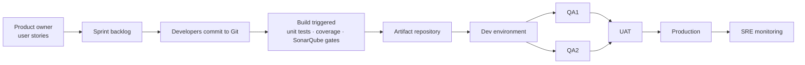
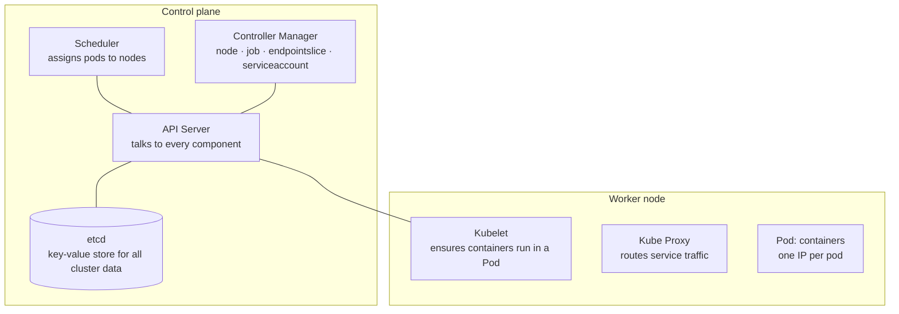

# Operations and Delivery

A design that cannot be deployed, observed, and rolled back is not finished.

## 1. The 12-Factor App

Twelve principles for building software that is reliable, scalable, and manageable. The config
factor matters immediately at L1; the rest become the L2 baseline.

| # | Factor | Meaning |
|---|---|---|
| 1 | **Codebase** | One codebase tracked in version control, many deploys |
| 2 | **Dependencies** | Explicitly declare and isolate dependencies; make them easy to install |
| 3 | **Config** | Store config (credentials, endpoints) in the environment, separate from code |
| 4 | **Backing services** | Treat databases, brokers, and third parties as attached resources, swappable by config |
| 5 | **Build, release, run** | Strictly separate the three stages |
| 6 | **Processes** | Execute as stateless processes; share nothing between them |
| 7 | **Port binding** | Export services via port binding; be self-contained |
| 8 | **Concurrency** | Scale out by adding processes, not by growing one |
| 9 | **Disposability** | Fast startup, graceful shutdown |
| 10 | **Dev/prod parity** | Keep development, staging, and production as similar as possible |
| 11 | **Logs** | Treat logs as event streams to stdout; do not manage log files |
| 12 | **Admin processes** | Run one-off admin tasks as separate processes against the same release |

**Factor 3 is the one that pays back immediately** — config separated from code is what makes the
same artifact promotable through environments, which is what makes releases repeatable.

---

## 2. How code ships to production

The canonical enterprise flow:

1. Product owner creates user stories from requirements
2. Dev team pulls stories into a sprint
3. Developers commit source to Git
4. A build triggers; source must pass unit tests, a coverage threshold, and static analysis gates
5. Successful builds are stored in an artifact repository, then deployed to dev
6. Multiple teams work on different features, tested independently in parallel QA environments
7. QA performs functional, regression, and performance testing
8. Passing builds go to UAT
9. Successful UAT builds become release candidates, deployed to production on schedule
10. SRE owns production monitoring

**Scale this to the level.** At L1 it is: push → tests → deploy. The ceremony above is an L2/L3
shape; imposing it on a prototype kills the thing it was meant to protect.

---

## 3. Configuration management vs Infrastructure as Code

**Traditional configuration management** maintains the desired state of configuration items —
servers, network devices, applications — *after* they have been provisioned. It typically involves
initial manual setup, with changes managed through step-by-step commands.

**Infrastructure as Code** treats infrastructure setup and change as software development.
Provisioning is automated and usually **declarative**: you describe the desired state rather than
the steps. Definitions live in version-controlled files.

Tools: Terraform, Bicep, CloudFormation, Pulumi (provisioning); Ansible, Chef, Puppet
(configuration).

The shift is toward automation, repeatability, and applying software engineering practice —
review, testing, versioning — to infrastructure.

---

## 4. GitOps

Git becomes the central hub for the entire lifecycle of applications *and* infrastructure, built on
version control, collaboration, and CI/CD.

Six key features:

1. **Version control and collaboration** — code, configuration, and infrastructure centralised in Git
2. **Declarative system** — describe the desired state, which makes it version-controllable
3. **Automated delivery** — Git-triggered deployment integrated with CI/CD
4. **Immutable infrastructure** — change via Git, never directly in the live environment, which
   prevents configuration drift
5. **Observability and feedback** — monitor in real time and reconcile actual state against declared state
6. **Security and compliance** — every change is tracked in Git with role-based access control

The reconciliation loop is the essential idea: an agent continuously compares the cluster to the Git
declaration and corrects drift. "Someone fixed it by hand in production" stops being possible.

---

## 5. Containers

**Docker architecture** — three components:

- **Docker client** — talks to the daemon
- **Docker host** — the daemon listens for API requests and manages images, containers, networks,
  and volumes
- **Docker registry** — stores images; Docker Hub is the public default, private registries are the
  norm in production

**What `docker run` actually does:**

1. Pulls the image from the registry
2. Creates a new container
3. Allocates a read-write filesystem layer to it
4. Creates a network interface connecting it to the default network
5. Starts the container

**Eight must-know concepts**

| Concept | What it is |
|---|---|
| **Dockerfile** | Instructions to build an image: base image, dependencies, run command |
| **Image** | A lightweight standalone package with everything needed to run the app; versioned |
| **Container** | A running instance of an image, isolated from others and the host |
| **Registry** | Centralised storage and distribution of images |
| **Volumes** | Persist data outside the container filesystem; shareable between containers |
| **Compose** | Define and run multi-container applications; manages the whole local stack |
| **Networks** | Enable communication between containers and the host; isolate or connect selectively |
| **CLI** | Build, run, manage volumes, and everything else |

---

## 6. Kubernetes

A container orchestration system for deployment and management, heavily influenced by Google's
internal Borg system.

A cluster is a set of worker machines (**nodes**) running containerised applications; every cluster
has at least one worker node. Worker nodes host the **Pods**. The **control plane** manages nodes and
Pods. In production the control plane runs across multiple machines and the cluster runs multiple
nodes, providing fault tolerance and high availability.

**Control plane components** — the **API server** talks to all components and all pod operations go
through it; the **scheduler** watches workloads and assigns newly created pods; the **controller
manager** runs the controllers; **etcd** is the backing store for all cluster data.

**Node components** — a **Pod** is a group of containers and the smallest unit Kubernetes
administers, with one IP address shared by every container in it; the **kubelet** is the per-node
agent ensuring containers run; **kube-proxy** routes traffic from a service to the correct containers.

### Ten Kubernetes design patterns

**Foundational** — principles for any application to be automated on Kubernetes:

1. **Health Probe** — every container must expose observable APIs so the platform can manage it
2. **Predictable Demands** — declare resource requirements and runtime dependencies; every container
   declares its resource profile
3. **Automated Placement** — the scheduling algorithm's principles (affinity, taints, tolerations)

**Structural** — organising containers within a Pod:

4. **Init Container** — a separate lifecycle for initialisation tasks
5. **Sidecar** — extend a container's functionality without changing it

**Behavioural** — Pod lifecycle management:

6. **Batch Job** — isolated atomic units of work
7. **Stateful Service** — distributed stateful applications
8. **Service Discovery** — how clients find services

**Higher-level** — application management:

9. **Controller** — monitor current state and reconcile toward the declared target state
10. **Operator** — encode operational knowledge in algorithmic, automated form

**When to adopt Kubernetes:** when you are running many services with real scaling and scheduling
needs. At L1 it is an enormous operational surface for one container; a PaaS or container service is
the right answer.

---

## 7. Nine components of a production microservice application

1. **API Gateway** — unified entry point; routing, filtering, load balancing
2. **Service Registry** — details of all services; the gateway discovers services here
   (Consul, Eureka, Zookeeper)
3. **Service Layer** — each microservice serving a business function, running multiple instances
4. **Authorization Server** — identity and access control (Keycloak, Entra ID, Okta)
5. **Data Storage** — per-service databases
6. **Distributed Caching** — Redis, Memcached, Couchbase
7. **Async Communication** — Kafka, RabbitMQ
8. **Metrics Visualization** — services publish to Prometheus; Grafana visualises
9. **Log Aggregation** — Logstash aggregates, Elasticsearch stores, Kibana visualises

**This list is the real cost of choosing microservices.** If a team cannot own all nine, the correct
answer is a modular monolith.

## 8. Ten components of a production web application

1. **CI/CD pipelines** deploying code to server instances (Jenkins, GitHub Actions)
2. **User requests** from the browser, after DNS resolution, reaching app servers
3. **Load balancers and reverse proxies** (Nginx, HAProxy) distributing requests
4. **CDN** serving cacheable content
5. **APIs** connecting the web app to backend services
6. **Database servers and distributed caches** providing data
7. **Job queues and workers** for resource-intensive and long-running tasks
8. **Full-text search service** (Elasticsearch, Solr)
9. **Monitoring tools** (Sentry, Grafana, Prometheus) storing logs and analysing data
10. **Alerting services** notifying developers (Slack, PagerDuty) for quick resolution

If one of these is missing from a design, that absence should be a decision rather than an oversight.

---

## 9. Cloud cost reduction

Six techniques, plus a bonus:

1. **Reduce usage** — tune volume and scale of resources without compromising performance
   (downsize instances, minimise storage, consolidate services)
2. **Terminate idle resources** — dormant instances, databases, storage
3. **Right sizing** — match instance sizes to actual demand; neither under- nor over-used
4. **Shut down during off-peak** — schedule non-essential resources off during low activity
   (non-production environments overnight and at weekends are usually the fastest win)
5. **Reserve to reduce rate** — Reserved Instances or Savings Plans matched to steady workloads
6. **Optimise data transfers** — compression and CDNs to cut bandwidth cost; position resources to
   favour **intra-region** transfer

**Bonus:** spot instances for interruptible work; lower-tier storage classes for cold data.

At L3, cost becomes an architectural constraint rather than a finance concern — a 5% efficiency gain
is a headcount. Netflix's Java 8 → 17 migration returned 20% CPU across the fleet, which is why
runtime upgrades are architecture work.

---

## 10. Software development lifecycle models

| Model | Shape | Best for |
|---|---|---|
| **Waterfall** | Linear and sequential: Requirements → Design → Implementation → Verification → Maintenance | Fixed, well-understood scope; regulated contexts |
| **Agile** | Small increments called sprints; Scrum, Kanban, XP | Evolving requirements, frequent feedback |
| **V-Model** | Waterfall extension where each development phase pairs with a testing phase, forming a V | Safety-critical systems requiring traceable verification |
| **Iterative** | Build incrementally; each iteration builds on the last | Large systems where the whole cannot be specified up front |
| **Spiral** | Iterative development plus systematic risk analysis each cycle: plan, risk-analyse, engineer, evaluate | High-risk, high-cost projects |
| **Big Bang** | All coding with minimal planning; integrate and test at the end | Tiny or experimental work only |
| **RAD** | Rapid prototyping and quick feedback | Projects where user feedback drives the design |
| **Incremental** | Design, implement, and test in increments until complete | Staged delivery with early value |

---

## 11. Ten good coding principles

1. **Follow code specifications** — established norms (PEP 8, Google Java Style) keep quality
   consistent and readable
2. **Documentation and comments** — explain *why* a decision was taken, not *what* the code does;
   keep them current
3. **Robustness** — handle unexpected situations and inputs without crashing or producing
   unpredictable results
4. **Follow SOLID** — Single responsibility, Open/closed, Liskov substitution, Interface segregation,
   Dependency inversion
5. **Make testing easy** — reduce component complexity and support automated testing
6. **Abstraction** — extract core logic and hide complexity; moderate, neither over-designed nor
   neglecting extensibility
7. **Use design patterns, but do not over-design** — every pattern has applicable scenarios;
   overuse makes code harder to understand
8. **Reduce global dependencies** — rely on localised state and parameter passing; keep functions
   side-effect free
9. **Continuous refactoring** — reduce technical debt by fixing problems as early as possible
10. **Security is a top priority** — avoid common vulnerabilities by default

---

## 12. Diagramming

Tools that turn code or text into diagrams, so architecture documentation stays in version control
and does not rot:

**Mermaid** — text-to-diagram, renders in GitHub/GitLab markdown natively. **The default choice**
for architecture documents, because the diagram lives in the same pull request as the code.

**PlantUML** — richer notation, full UML support, good for detailed sequence and class diagrams.

**Diagrams / Go-Diagrams** — generate cloud architecture diagrams from Python or Go code, with
provider icon sets (AWS, Azure, GCP, K8s).

**Markmap** — mind maps from markdown; useful for knowledge maps rather than architecture.

**ASCII editors** — plain-text diagrams that survive anywhere, including code comments and terminals.

### UML class diagram building blocks

For detailed design documentation: **Class** (blueprint defining properties and behaviour),
**Attributes** (data fields), **Methods** (behaviour), **Interfaces** (a contract implementing
classes must fulfil), **Enumeration** (a named value set), and **Relationships** — association,
aggregation, composition, inheritance, and implementation.

---

## 13. Monitoring infrastructure

The aspects any monitoring setup must cover, whichever cloud or tooling:

- **Data collection** — gather from diverse sources
- **Data storage** — retain safely for future analysis
- **Data analysis** — extract insight that drives action
- **Alerting** — real-time notification of critical events and anomalies
- **Visualization** — present data comprehensibly
- **Reporting and compliance** — generate reports, meet regulatory standards
- **Automation** — automated workflows in response to conditions
- **Integration** — connect and exchange data between systems
- **Feedback loops** — refine strategies based on observed performance

See `10-reliability-and-failure.md` §11 for the RED/USE frameworks and alerting philosophy.
