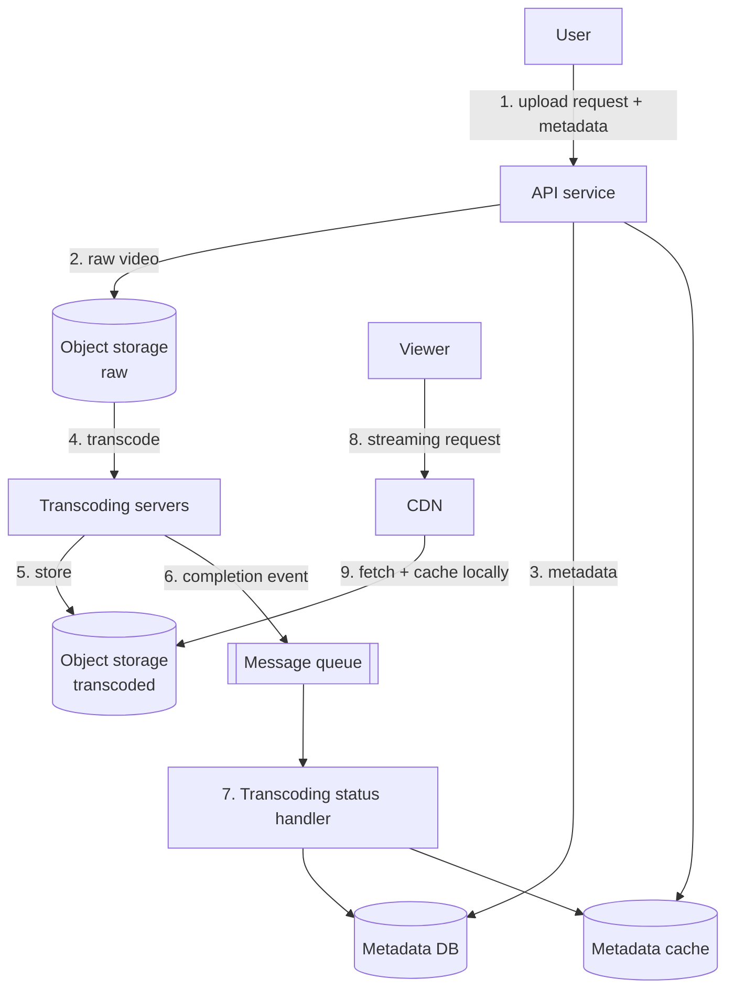
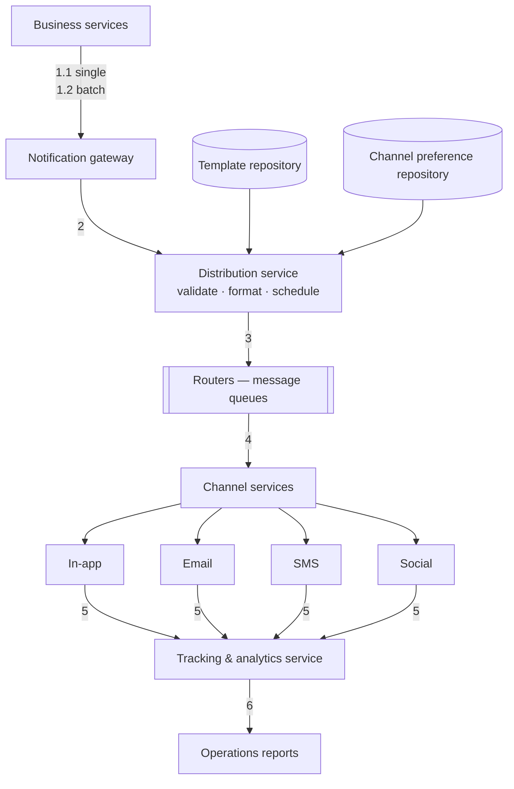
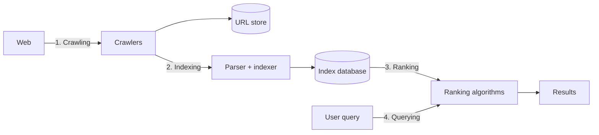
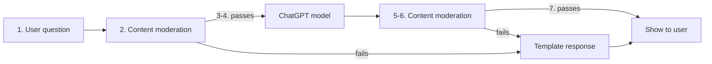

# Worked Designs

Complete walkthroughs of well-known systems. Use these as templates for structure and as evidence
for the level rubric — note how few components each one actually needs.

---

## 1. Design a video platform (YouTube-like)

Nine steps, upload through playback:



1. User creates an upload request with the video file and details
2. Raw video files are uploaded to **object storage** (S3/Blob) — never the database
3. Metadata is saved to a database **and a cache** for faster retrieval
4. Raw files are sent to dedicated **transcoding servers** — encoding into compatible bitrates and
   formats for streaming
5. The transcoded video is uploaded to a second object storage bucket
6. A transcoding-completion notification goes to a service via a **message queue**
7. The transcoding status handler updates the metadata DB and cache
8. A viewer's streaming request goes to the **CDN**
9. The CDN fetches from object storage and **caches locally** for subsequent requests

**Design lessons:** separate raw and processed storage; make transcoding asynchronous and idempotent
(it will fail and be retried); metadata and blobs live in different systems; the CDN, not your
servers, serves bytes at scale.

---

## 2. Live streaming (YouTube Live / TikTok Live / Twitch)

Live streaming is hard because video content must traverse the internet in near real time, video
processing is compute-intensive, and the volume is large.

```mermaid
flowchart LR
    S[Streamer<br/>video+audio → encoder] -->|1-2| POP[Point-of-presence server<br/>nearest to streamer]
    POP -->|3. transcode to<br/>multiple resolutions<br/>+ split into segments| TR[Transcoder]
    TR -->|4. package to HLS| PKG[Packager]
    PKG -->|5. cache manifest + chunks| CDN[CDN]
    CDN -->|6| P[Viewer's player]
    PKG -.7-8. optional.-> S3[(S3 for replay)]
```

1. The streamer starts; the source is any video/audio wired to an encoder
2. Platforms provide **point-of-presence servers worldwide** so the streamer connects to the nearest
   one — upload conditions matter as much as download
3. The incoming stream is transcoded to different resolutions and **divided into segments a few
   seconds long**
4. Segments are packaged into a live-streaming format players understand — most commonly **HLS**
5. The resulting HLS manifest and video chunks are cached by the CDN
6. Video arrives at the viewer's player
7–8. Optionally stored (S3) to support replay

**Design lessons:** segmentation is what makes adaptive bitrate possible; the PoP server exists
because upstream latency is the streamer's bottleneck; end-to-end latency is the sum of segment
duration plus buffering, so segment length is the core latency/robustness trade-off.

---

## 3. Push notification system

Covers in-app notifications, email, SMS/OTP, and social media pushes.



1. Business services send notifications to the gateway, which handles both single and batch modes
2. The gateway forwards to the distribution service where messages are **validated, formatted, and
   scheduled**. A **template repository** holds pre-defined message formats; a **channel preference
   repository** holds each user's preferred delivery channels
3. Notifications are sent to routers — normally message queues
4. Channel services communicate with internal and external delivery channels
5–6. Delivery metrics are captured by tracking and analytics, where operations can view reports

**Design lessons:** the template and preference repositories are what keep this from becoming
per-service notification code; queues between distribution and channels absorb provider outages;
tracking is not optional — undelivered notifications are invisible without it.

### Firebase Cloud Messaging (the device delivery leg)

1–2. On first start, the client app sends credentials (Sender ID, API Key, App ID) to FCM, which
generates a **Registration Token** (also called Instance ID) for that app instance
3. The client sends the token to the app server, which caches it. Over time the server accumulates
too many tokens, so the recommended practice is to **store tokens with timestamps and remove stale
ones periodically**
4. Messages can be composed in the console GUI (4.1) or sent from the app server (4.2) via the
Firebase Admin SDK or HTTP
5. FCM receives messages and **queues them in storage if devices are offline**
6. FCM forwards to platform-level transport, which handles platform-specific configuration
7. Messages are routed to target devices

Messages can also be sent to a **topic**, exactly like Kafka, for broadcast subscriptions.

---

## 4. Search engine



1. **Crawling** — web crawlers scan the internet, following URL links from page to page and storing
   URLs in a URL store. They discover new content: pages, images, videos, files
2. **Indexing** — once crawled, the page is parsed and its content indexed in a database. Content is
   analysed and categorised: keywords, site quality, content freshness, and many other factors
3. **Ranking** — complex algorithms determine result order using keywords, relevance, content
   quality, user engagement, page load speed, and more. Some engines personalise on search history,
   location, and device
4. **Querying** — the engine sifts its index to return the most relevant results

**Design lessons:** the inverted index is the core data structure; crawl and query are entirely
separate pipelines with different scaling characteristics; freshness and coverage are in permanent
tension with cost.

---

## 5. A ChatGPT-like system

Two distinct parts: training and serving.

### Training

**Pre-training** — train a GPT model (decoder-only transformer) on a large chunk of internet data.
The objective is to predict the next word given a sentence, grammatically correct and semantically
meaningful. After pre-training the model can complete sentences but cannot answer questions.

**Fine-tuning** — a three-step process turning the pre-trained model into a question-answering model:

1. Collect training data (questions and answers) and fine-tune on it; the model learns to generate
   an answer given a question
2. Collect more data (a question with several answers) and train a **reward model** to rank answers
   from most to least relevant
3. Use reinforcement learning (**PPO** optimisation) to fine-tune so answers are more accurate

### Serving a prompt



**Design lesson that generalises to every LLM product:** moderation runs on **both** the input and
the output, and both failure paths converge on a template response. Most production LLM incidents
come from omitting the output-side check.

---

## 6. Payments

### The payments ecosystem

**Steps 0–1** — the cardholder opens an account with the **issuing bank** and receives a card. The
merchant registers with an ISO (Independent Sales Organization) or MSP (Member Service Provider) for
in-store sales; ISO/MSP partners with payment processors to open merchant accounts.

**Steps 2–5 — the acquiring process.** The **payment gateway** accepts the transaction and collects
payment information. It goes to a **payment processor**, which uses customer information to collect
payment. The **acquiring processor** sends the transaction to the card network and owns the
merchant's account during settlement — **which does not happen in real time**.

**Steps 6–8 — the issuing process.** The **issuing processor** talks to the card network on the
issuing bank's behalf, validating and operating the customer's account.

### The economics (why the card is "the most profitable product in banks")

On a $100 purchase:

| Party | Take | Name |
|---|---|---|
| Merchant | pays the fee | **merchant discount fee** |
| Acquiring bank | keeps $0.25 | **acquiring markup** |
| Issuing bank | receives $1.75 | **interchange fee** |
| Card network | 0.11% assessment + $0.0195 per swipe | **network assessments and fees** |

The interchange fee is set by the card network because it is less efficient for each issuing bank to
negotiate with each merchant.

**Why the issuer is compensated:** it pays the merchant even if the cardholder never pays; it pays
the merchant *before* the cardholder pays; and it carries the cost of account management,
statements, fraud detection, risk management, and clearing and settlement.

### Scan-to-pay (QR)

Two sub-processes.

**Merchant generates the QR code** (all seven steps complete in under a second):

1. The cashier tallies goods and calculates the total (e.g. $123.45, order ID SN129803), clicks checkout
2. The cashier's computer sends the order ID and amount to the PSP
3. The PSP saves this to the database and generates a QR code URL
4. The PSP's payment gateway reads the QR code URL
5. The gateway returns the URL to the merchant's computer
6. The merchant's computer sends the URL (or image) to the checkout counter
7. The counter displays the QR code

**Consumer pays:**

1. The consumer opens their digital wallet app and scans the code
2. After confirming the amount, they tap pay
3. The wallet notifies the PSP that the consumer has paid the given QR code
4. The PSP marks the QR code paid and returns success to the wallet
5. The PSP notifies the merchant that the code has been paid

**Design lessons:** the QR encodes a *reference*, not payment data; the order ID is the idempotency
anchor for the whole flow; settlement is asynchronous and separate from authorisation, which is why
"paid" and "settled" are different states in every payment schema.

---

## 7. What happens when you type a URL into a browser

The canonical end-to-end question, worth knowing precisely:

1. **Parse the URL** — four parts: scheme (`http://` — tells the browser to use HTTP), domain
   (`example.com`), path (`product/electric`), resource (`phone`)
2. **DNS lookup** — the browser resolves the domain to an IP. Cached at multiple layers: browser
   cache, OS cache, local network cache, ISP cache. If not found at any, the browser performs a
   **recursive DNS lookup** through root → TLD → authoritative nameservers
3. **TCP connection** — the browser establishes a connection with the server at that IP
   (plus a TLS handshake for HTTPS)
4. **HTTP request** — `GET /phone HTTP/1.1` with a `Host:` header
5. **Server processes and responds** — status `200 OK` with headers (Date, Server, Content-Type) and
   the HTML body
6. **Browser renders** the HTML content — parsing, building the DOM, fetching subresources, painting

**The DNS caching hierarchy is the part most people omit**, and it is why a DNS change appears to
take hours to propagate.

---

## 8. How data travels the network (OSI encapsulation)

Sending from Device A to Device B:

1. An **HTTP header** is added at the application layer
2. A **TCP or UDP header** is added at the transport layer — source port, destination port, sequence
   number — producing segments
3. An **IP header** is added at the network layer — source and destination IP addresses
4. A **MAC header** is added at the data link layer — source and destination MAC addresses
5. Frames go to the physical layer and travel as binary bits

6–10. Device B performs de-encapsulation: headers are removed layer by layer until the data is readable.

**Why layers exist:** each layer focuses on its own responsibility, relies on its own header for
processing instructions, and does not need to understand the data from the layer above. It is
encapsulation applied to networking, and it is the reason you can change from Ethernet to Wi-Fi
without changing HTTP.

---

## 9. Stack Overflow — the counterexample worth memorising

**What an interviewer expects:**

1. Microservices decomposing the system into small components
2. Each service with its own database, using cache heavily
3. Sharded services
4. Asynchronous communication through message queues
5. Event sourcing with CQRS
6. Distributed-systems vocabulary: eventual consistency, CAP theorem

**What it actually is:** Stack Overflow serves all its traffic with **nine on-premise web servers,
on a monolith**. Its own servers. Not the cloud.

**Use this deliberately.** When a design is drifting toward complexity, the question "what would
this look like if we built it the way Stack Overflow did?" is a genuinely useful forcing function.
The right architecture is the one that works in reality, not the one that performs well in a
whiteboard interview.

---

## 10. How to use these

When designing something new, find the closest analogue above and start from its shape rather than
from a blank page. Then:

1. **Delete every component you cannot justify in one sentence.** The YouTube design has nine steps;
   your video POC probably needs three.
2. **Identify which components exist purely for scale.** CDN, transcoding fleet, and separate raw
   and processed buckets are L3 concerns. At L1, one bucket and synchronous ffmpeg is a complete
   design.
3. **Keep the ordering.** The sequence of these flows (validate → store → process async → notify →
   serve from edge) is correct at every level; only the number of boxes changes.
