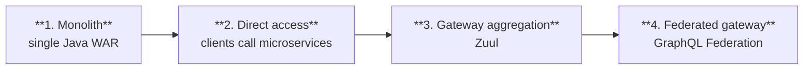

# Case Studies — How Real Systems Actually Scaled

Every architecture here was reached **gradually, under measurement, one forced move at a time**.
None of them started where they ended. That is the single most important lesson in this document.

---

## 1. Discord — trillions of messages, two database migrations

**MongoDB → Cassandra → ScyllaDB**

| Year | State | What broke |
|---|---|---|
| 2015 | Single MongoDB replica | — |
| Nov 2015 | 100M messages | RAM could no longer hold data **and** index; latency became unpredictable |
| 2017 | 12 Cassandra nodes, billions of messages | — |
| Early 2022 | 177 Cassandra nodes, trillions of messages | Latency unpredictable; maintenance too expensive to run |

**Why Cassandra stopped working — three compounding reasons:**

1. **LSM tree read cost.** Cassandra uses an LSM tree internally, where reads are more expensive
   than writes. With hundreds of users concurrently reading one channel, concurrent reads on a single
   server created **hotspots**.
2. **Cluster maintenance.** Compacting SSTables impacted performance during normal operation.
3. **Garbage collection pauses** caused significant latency spikes — Cassandra runs on the JVM.

**The fix:** ScyllaDB — a Cassandra-compatible database written in **C++**, so no GC pauses at all.
Discord redesigned around a monolithic API, a data service written in Rust, and ScyllaDB storage.

**Results:**

| Metric | Cassandra | ScyllaDB |
|---|---|---|
| p99 read latency | 40–125 ms | **15 ms** |
| p99 write latency | 5–70 ms | **5 ms** |

**Lessons**

- A single MongoDB replica carried them to 100 million messages. **The starting point was L1.**
- The storage engine (LSM vs B-tree) becomes an architectural decision at scale, not an
  implementation detail.
- **Runtime characteristics are architecture.** GC pauses drove a database migration. This is the
  same reason Netflix's Java upgrades are architecture work.
- Ten years, two migrations. Each was forced by a specific measured problem, not anticipated.

---

## 2. Figma — 100× Postgres growth

3 million monthly users, a user base up 200% since 2018, and a Postgres database that grew 100×.

Their path, in order:

**1. Vertical scaling and replication**
Started with a single large Amazon RDS database. First step: upgrade to the largest instance
available — `r5.12xlarge` → `r5.24xlarge`. Added multiple **read replicas** to scale read traffic,
and **PgBouncer** as a connection pooler to limit the impact of a growing connection count.

**2. Vertical partitioning**
Migrated high-traffic tables — "Figma Files" and "Organizations" — into their own separate
databases. Multiple PgBouncer instances managed connections for these.

**3. Horizontal partitioning**
Over time some tables crossed **several terabytes and billions of rows**. Two specific things broke:
**Postgres Vacuum** became a problem, and **max IOPS exceeded the limits of Amazon RDS** at the time.
They split large tables across multiple physical databases and built a new **DBProxy** service to
handle routing and query execution.

**Lessons**

- This is the scaling ladder, executed exactly in order: vertical → replicas → pooling → vertical
  partitioning → horizontal partitioning.
- **100× growth before horizontal partitioning was needed.** If you are considering sharding, ask
  honestly whether you have grown 100× on a maxed-out instance.
- The triggers were concrete and measurable: vacuum behaviour and an IOPS ceiling. Not "we might
  need to scale".
- Sharding required building new infrastructure (DBProxy). Sharding is never just a database change.

---

## 3. Reddit — over 1 billion users a month

Ten architectural facts:

1. A **CDN from Fastly** fronts the application
2. Frontend history: jQuery in early 2009 → TypeScript → modern Node.js frameworks, plus native
   Android and iOS apps
3. Within the application stack, a **load balancer** routes incoming requests to the appropriate services
4. Started as a **Python monolith**; has since been moving to **microservices built in Go**
5. Heavy use of **GraphQL** for the API layer. Moved to **GraphQL Federation** in early 2021,
   combining smaller GraphQL APIs known as Domain Graph Services. In 2022 they added several Go
   subgraphs for core entities, **splitting the GraphQL monolith**
6. **Postgres** for the core data model, with **memcached in front of Postgres** to reduce load.
   **Cassandra** used heavily for new features, mainly for its resiliency and availability properties
7. **Debezium** running a Change Data Capture process to support data replication and cache consistency
8. Expensive operations — a user voting or submitting a link — are **deferred to an async job queue
   via RabbitMQ** and processed by job workers. **Kafka** transfers data in real time for content
   safety checks and moderation
9. **AWS and Kubernetes** as the hosting platform
10. **Spinnaker, Drone CI, and Terraform** for deployment and infrastructure

**Lessons**

- **A billion users a month, still on Postgres.** With memcached in front. This is the strongest
  available argument against premature exotic datastores.
- Two brokers for two distinct jobs: RabbitMQ for work queues, Kafka for real-time streaming.
- Monolith → microservices was incremental and is still in progress, over 15 years.
- Even the GraphQL layer became a monolith that needed splitting — every layer eventually faces the
  same decomposition question.

---

## 4. Netflix — the reference architecture

### API architecture evolution — four stages

1. **Monolith** — packaged and deployed as one artifact, a single Java WAR. *Most startups begin here.*
2. **Direct access** — clients call microservices directly. With hundreds or thousands of services,
   exposing them all to clients is not viable.
3. **Gateway aggregation layer** — some use cases span multiple services. Rendering one Netflix
   screen needs movie, production, and talent APIs; the gateway aggregation layer makes that possible.
4. **Federated gateway** — as developer count and domain complexity grew, developing the aggregation
   layer itself became harder. GraphQL Federation gives a single gateway fetching from all other APIs.

### The Java story in detail

Every backend application at Netflix — internal apps, streaming, movie production — is a **Java
application**. The stack iterated:

**1. API Gateway** — every piece of functionality and data owned by a microservice built in Java
(initially Java 8). Rendering one screen (the "List of List of Movies", LOLOMO) involved fetching
from tens of microservices. Making all those calls from the client created a performance problem, so
Netflix used the API Gateway pattern with **Zuul** for orchestration.

**2. BFFs with Groovy and RxJava** — a single gateway for multiple clients was a problem because each
client (TV, mobile, web) had subtle differences. Netflix adopted the **Backend-for-Frontend** pattern;
Zuul moved to a proxy role. Every frontend got its own mini backend performing request fan-out and
orchestration. Built with Groovy scripts, with RxJava handling thread management for the fan-out.

**3. GraphQL Federation** — the Groovy/RxJava approach required more work from UI developers writing
Groovy scripts, and **reactive programming is generally hard**. Netflix moved to GraphQL Federation:
clients specify exactly the fields they need, solving over- and under-fetching. The microservices are
called **Domain Graph Services (DGS)**, built with **Java 17 and Spring Boot 3**.

**The move from Java 8 to Java 17 resulted in 20% CPU gains.** Netflix has since started migrating to
Java 21 for virtual threads.

### The full tech stack

| Layer | Technology |
|---|---|
| Mobile and web | Swift and Kotlin for native apps; React for web |
| Frontend/server communication | GraphQL |
| Backend services | ZUUL, Eureka, Spring Boot |
| Databases | EVCache, Cassandra, CockroachDB |
| Messaging/streaming | Apache Kafka, Flink |
| Video storage | S3 and Open Connect |
| Data processing | Flink and Spark; Tableau for visualisation; Redshift for the structured warehouse |
| CI/CD | JIRA, Confluence, PagerDuty, Jenkins, Gradle, **Chaos Monkey**, Spinnaker, Atlas |

### Four ways Netflix uses caching

The goal is to keep you streaming, and a typical attention span is **90 seconds** — so latency is
retention. Netflix uses **EVCache**, a distributed key-value store, in four distinct roles:

1. **Lookaside cache** — the application tries the EVCache client first; on a miss it goes to the
   backend service and Cassandra, then updates the cache for future requests
2. **Transient data store** — playback session information: one service starts the session, another
   updates it, another closes it
3. **Primary store** — large-scale pre-compute systems run **every night** to compute a brand-new
   home page for every profile of every user based on watch history and recommendations. All that
   data is written into the EVCache cluster; online services read from it to build the homepage
4. **High-volume data** — data with high access volume that must be highly available, such as UI
   strings and translations. A separate process asynchronously computes and publishes them to
   EVCache, read with low latency and high availability

**Lessons**

- The same caching technology occupies four architectural roles. A cache used as a *primary store*
  is a legitimate design when the data is derived and reproducible.
- Precompute is a scaling strategy in its own right: doing the expensive work nightly turns a
  complex runtime query into a key lookup.
- Netflix moved *away* from reactive programming because it was too hard for the team. Team
  capability is a legitimate architectural constraint.

---

## 5. Stack Overflow — the anti-hype benchmark

**What people expect:** microservices, per-service databases, heavy caching, sharding, async
message queues, event sourcing with CQRS, and distributed-systems vocabulary.

**What it actually is:** all traffic served by **nine on-premise web servers**, running a
**monolith**. Its own hardware. Not the cloud.

**Lesson:** the question is not "what looks impressive?" but "what works in reality?" Keep this
number handy as a forcing function whenever a design starts accumulating components.

---

## 6. Pinterest — the one-line change

The Engineering Productivity team changed one line in the Jenkins pipeline for **Pinboard**, their
oldest and largest monorepo:

- 350K commits
- 20 GB when fully cloned
- 60K git pulls every business day

The Checkout stage already used a shallow clone, no tag fetching, and only the last 50 commits. But
it did not set the **Git refspec** option — so Git fetched *all* refspecs on every build, meaning
**more than 2,500 branches**.

The fix: specify the refspec for the one branch they cared about (`master`).

**Clone times went from 40 minutes to 30 seconds — a 99% reduction.**

**Lesson:** measure before you architect. The instinct here would have been to shard the repo,
introduce a build cache, or move to a distributed build system. The actual bottleneck was one
missing configuration flag. This is the most common shape of a real performance problem.

---

## 7. Redis — how a system evolves over time

A useful model for how any successful system grows:

| Year | Version | What was added | Why |
|---|---|---|---|
| 2010 | 1.0 | Standalone in-memory cache | Simple; used as a cache in front of the application |
| 2013 | 2.8 | **Persistence** — RDB snapshots and AOF (append-only file) | On restart all data was lost and traffic hit the database directly |
| 2013 | 2.8 | **Replication** | Increase availability; primary handles reads/writes, replica syncs |
| 2013 | 2.8 | **Sentinel** | Monitoring, notification, automatic failover, configuration provider |
| 2015 | 3.0 | **Cluster** — sharding across **16,384 slots**, each node owning a portion | Distributed data management |
| 2017 | 5.0 | Stream data type | New use cases |
| 2020 | 6.0 | **Multi-threaded I/O** in the network module | The network module had become the bottleneck |

**Lesson:** the progression — single node → durability → replication → automatic failover →
sharding → internal parallelism — is the same order the scaling ladder prescribes. Even the systems
you build on top of followed it.

---

## 8. Cross-cutting lessons

1. **Everyone started with a monolith and one database.** Netflix, Reddit, Discord, Figma. Every one.
2. **Every migration was forced by a specific measured failure**, never by anticipation: RAM
   exhaustion, GC pauses, an IOPS ceiling, vacuum behaviour, teams blocking each other.
3. **The scaling ladder is empirical, not theoretical.** Figma climbed it rung by rung over 100×
   growth.
4. **Boring databases go extraordinarily far.** Reddit at a billion users a month runs Postgres with
   memcached.
5. **Organisational scale drives architecture as much as traffic.** GraphQL Federation solved a team
   ownership problem at both Netflix and Reddit — the query flexibility was secondary.
6. **Runtime and engine characteristics are architecture** — GC pauses, LSM read amplification, JVM
   version. A 20% CPU gain across a fleet is worth a migration.
7. **Measure first.** Pinterest's 99% improvement was a configuration flag.

When designing, the question is not "how would Netflix build this?" It is **"what did Netflix look
like when they had our traffic?"** — and the answer is almost always: a monolith with one database.
